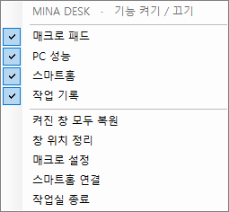

# Mini Workstation Hub

## 0.6.0.0 · GitHub 프로젝트와 선택적 PC 공유

**＋ → GitHub에서 추가 → GitHub 로그인 → 저장소 체크 → 프로젝트 등록**으로 로컬 폴더 없이 시작합니다. 접근 권한이 있는 Public·Private 저장소의 모든 페이지를 조회하며, GitHub 프로젝트는 선택창에 ☁ 표시를 붙입니다. 기존 로컬 폴더 추가도 같은 화면에서 선택할 수 있습니다.

프로젝트 옆 **설정**에서 클라우드/이 PC, 코딩·PR/자료 대화·검토, 프로젝트별 공유를 저장합니다. GitHub 프로젝트에 같은 저장소를 복제한 폴더를 나중에 연결하면 프로젝트 ID와 스킬 버튼을 유지합니다. 다른 저장소·포크·Git 원격이 없는 폴더는 연결을 중지합니다. 자동 복제·Push·Pull은 수행하지 않습니다.

공식 GitHub CLI 2.105.0을 SHA-256 검증 후 앱에 포함합니다. 기본 브라우저에서 GitHub CLI OAuth 인증을 완료하며 인증 정보는 Windows 자격 증명 저장소를 사용합니다. 별도 GitHub App 인증 서버가 필요하지 않습니다. CLI 기본 OAuth 범위는 `repo`, `read:org`, `gist`이며 조직의 SSO·OAuth 앱 승인이 별도로 필요할 수 있습니다. Hub의 WebView에는 토큰을 보내지 않고, CLI의 평문 토큰 저장 폴백은 거부합니다. 일반 GitHub CLI 설정과는 별도 설정 폴더를 사용합니다.

**비공개 공유 저장소 연결·만들기**를 누르면 로그인 계정의 전용 `mini-workstation-hub-settings` 비공개 저장소를 사용합니다. 공유한 프로젝트의 목록·공통 스킬 버튼만 보관합니다. 로컬 폴더·스킬 절대 경로·실행 위치·위치별 예외·로그인 정보는 공유하지 않습니다. 다른 PC에서도 같은 계정으로 로그인하고 공유 저장소를 연결하면 선택한 프로젝트를 가져옵니다. 시작 시·설정 변경 후·1분 간격·수동으로 동기화하며, 동시 수정은 충돌로 표시해 사용자가 유지할 버전을 고릅니다. 공유 해제는 원격 상태에 반영하며 이미 기록된 GitHub 저장소의 커밋 이력을 지우는 기능은 아닙니다.

스킬 편집의 **저장 범위**에서 프로젝트 공통 버튼과 이 PC의 현재 실행 위치 예외를 나눕니다. 클라우드에 있는 스킬 문서는 저장소 안의 상대 경로로 지정합니다. 개인 PC의 스킬 파일을 자동 업로드하지 않습니다. 클라우드·자료 대화는 **AI 작업 준비**에서 앱을 열고 요청문을 복사한 뒤 AI 앱에서 저장소·환경·권한을 확인해 직접 전송합니다. 외부 앱 연결만으로 클라우드 환경까지 선택됐다고 표시하지 않습니다.

기존 0.5 설정은 파일 백업과 프로젝트·버튼 ID를 유지하며 새 형식으로 읽습니다. 서명된 검사에서 기존 35개와 새 GitHub·공유·클라우드 38개, 총 73개를 확인했습니다. 실제 UI 파일의 샘플 계정 흐름도 검증했으며 실제 OAuth 승인과 물리적으로 다른 두 PC의 동기화는 사용자 계정에서 추가 확인해야 합니다.

아래 0.5 설명은 이전 버전의 동작 이력입니다.

0.5.2.0: 스킬 이름은 원래 이름으로 표시하고, 설치된 스킬의 목록·상세 설명을 한국어로 표시합니다. 한국어로 된 원래 설명은 유지하며 새 영어 스킬의 번역이 없으면 한국어 안내를 표시합니다. 스킬 파일과 실행 요청은 변경하지 않습니다. 사용자 정의 이름도 같은 방식으로 처리합니다.

## 개발 버전 0.5.0.0 · 프로젝트 스킬 버튼

매크로 패드의 **스킬** 버튼이 설치된 스킬 선택 화면을 엽니다. 프로젝트 옆 **＋**로 실제 프로젝트 폴더를 선택하고, 스킬·버튼 이름·GPT 또는 Claude 데스크톱 앱·자주 사용할 요청문을 등록합니다. 등록한 버튼은 아래의 **프로젝트 스킬** 영역에 계속 추가되며 12개로 제한하지 않습니다. 프로젝트를 바꾸면 해당 프로젝트의 버튼만 보입니다. 수정·삭제도 스킬 화면에서 합니다.

설정은 로컬 앱 데이터의 `MinaDesk/WorkstationHub/skill-workspaces.json`에 저장합니다. 앱을 다시 켜면 마지막 프로젝트와 버튼, 업무 시작 옆 AI 앱 선택을 복원합니다. 파일을 원자적으로 교체하고 `.bak` 백업을 남기며, 손상 시 백업을 복원하거나 기존 파일을 보존한 채 저장을 중지합니다. 이 설정은 PC별 로컬 설정입니다.

스킬 목록은 사용자와 현재 프로젝트의 `.agents/skills`, `.codex/skills`, `.claude/skills`, Codex 기본 스킬을 읽습니다. Git 저장소 안에서는 프로젝트 상위 경로의 스킬도 저장소 루트까지 확인합니다. GitHub에만 있는 스킬이나 플러그인 캐시의 모든 버전을 설치 목록으로 간주하지 않습니다. 이름이 같아도 출처·파일이 다른 스킬은 별도로 표시합니다.

스킬 버튼은 선택한 프로젝트의 **새 작업**에 SKILL.md 경로와 요청을 전달합니다. GPT는 설치된 GPT 앱의 `codex://threads/new`, Claude는 `claude://code/new` 공식 연결을 사용합니다. **공식 연결 자체는 요청문을 준비하며 자동 전송하지 않습니다.** 허브는 Windows 접근성에서 현재 AI 앱·정확히 일치하는 작성 중인 요청문·전송 버튼을 확인한 경우 한 번만 전송합니다. 다른 내용, 불명확한 입력창, 프로젝트 접근 확인, 앱 미설치 상황에서는 자동 승인을 하지 않고 앱에서 확인이 필요하다고 표시합니다. ‘요청 전송됨’은 AI 작업 완료를 뜻하지 않습니다. 각 AI 앱의 도구·스킬 형식·프로젝트 접근 지원에 따라 실행 가능 범위가 다릅니다.

업무 시작 옆 작은 메뉴는 **GPT / Claude / 둘 다**의 마지막 선택을 기억합니다. 업무 시작은 work-cycle을 기본 브라우저로, AI 앱을 선택한 프로젝트에서 열도록 요청합니다. VS Code와 터미널도 현재 프로젝트를 사용하며 터미널은 Git Bash 우선, 미설치 시 Windows PowerShell을 엽니다. 집중 표시 버튼은 허브의 표시만 바꾸며 휴대폰·Windows 방해금지를 제어하지 않습니다. 퇴근·잠금 및 PC 잠금은 실제 Windows 잠금 명령이므로 시험 전에 사용자에게 알립니다.

0.5 컴파일, 기존 JavaScript 상태 검사, 프로젝트 저장·복원·분리·복구와 데스크톱 링크/전송 보호 35개 검사를 확인했습니다. 이 PC의 새 GUI 실행 파일은 Windows 앱 제어가 차단해 **0.5 실제 설치·AI 앱 자동 전송은 아직 검증하지 못했습니다**. 기존 인증서로 서명한 패키지는 별도 제공하며 Store 서명과는 구분합니다. 실제 앱 UI 파일은 PC 명령과 AI 전송을 차단한 브라우저 시험 모드로 검증합니다.

[GPT 데스크톱 연결 문서](https://learn.chatgpt.com/docs/app/commands.md) · [Claude 데스크톱 연결 문서](https://support.claude.com/en/articles/14729294-open-claude-desktop-with-a-link)

```powershell
node tests/macro-ui.cjs
node tests/smart-ui.cjs
.\tests\test-skills.ps1
```

작업실에서 자주 쓰는 **매크로 패드, PC 성능, 스마트홈, 작업 기록**을 네 개의 독립된 Windows 창에 띄우는 데스크톱 앱입니다. PC 성능은 실제 측정값을 표시하며, Store 비공개 테스트 버전 0.3은 방별 Home Assistant 연결과 개인 영상 보관을 추가합니다. 가상 조명·냉방·3D 작업실은 별도의 시연 영역입니다.

## Store 비공개 테스트 0.3.0.0 · 스마트홈

스마트홈 창에서 **방을 먼저 선택**하고 각 집의 Home Assistant 기기를 연결합니다. 기기 상태와 지원 기능을 읽어 사용 가능한 버튼을 켜며, 끊긴 센서는 ‘확인 불가’로 표시합니다. 청소 시작·일시정지·복귀, 방 청소용 HA 스크립트, Music Assistant의 클래식·인기가요 재생목록, 창문·건조기 상태를 제공합니다. 실제 모델별 지원과 사용자의 기기 연결 시험은 별도로 필요합니다.

영상 보관은 **전송 폴더 → 내용 중복·재생 길이 확인 → 원본 보관 → 날짜별 편집 → YouTube 비공개 업로드 → 처리·비공개 확인**으로 이어집니다. 전송 중단 시 저장한 세션 위치부터 이어 보내며, 세션이 만료되면 Studio 확인 전까지 새 업로드를 멈춥니다. 원본 파일과 휴대폰 파일은 삭제하지 않습니다. 늦게 도착한 원본은 기존 작업에 포함되지 않은 것만 추가 편집합니다.

### 처음 연결하기

1. 스마트홈의 **연결 설정** 또는 병아리 메뉴의 **스마트홈 연결**을 엽니다. 집 연결 탭에 HA 주소와 사용자가 생성한 장기 액세스 토큰을 입력하고 기기 목록을 확인합니다.
2. **방과 기기**에서 기본 방 이름을 바꾸고 대상 entity_id를 연결합니다. ‘이 방 다시 청소’는 HA에서 해당 방을 청소하는 스크립트를 먼저 검증해 연결합니다. 음악은 HA의 Music Assistant 통합, 해당 플레이어 entity_id와 재생목록 URI가 필요합니다. YouTube Music 제공자 로그인은 Music Assistant에서 합니다.
3. **영상 보관**에서 휴대폰 전송 폴더와 별도의 보관 폴더, 외부 `ffmpeg.exe` 위치를 지정합니다. 같은 폴더의 `ffprobe.exe`와 H.264 인코더가 필요합니다. FFmpeg는 이 앱에 포함하지 않습니다. [FFmpeg 공식 다운로드](https://ffmpeg.org/download.html)
4. Android의 PhotoSync 등 전송 도구에서 **맘카가 저장한 앨범만** PC 전송 대상으로 선택합니다. Hub의 **전송 폴더** 버튼이 선택한 방의 실제 폴더를 엽니다. 첫 방은 설정의 전송 폴더 바로 아래 파일도 수집합니다. 전송 서버·공유 폴더와 Android 전송 설정은 별도 준비가 필요합니다.
5. U+ 앱에서 영상 한 편을 갤러리에 내려받아 전송합니다. Hub에서 원본 보관과 날짜·재생 길이를 확인하고, 완성 영상을 열어 본 뒤 휴대폰 파일을 직접 정리합니다. 이 버전은 U+ 앱 다운로드와 Android 갤러리 삭제를 자동 조작하지 않습니다.
6. **유튜브**에서 기존 Google Cloud 데스크톱 OAuth JSON을 선택하고 기본 브라우저에서 직접 연결합니다. YouTube Data API와 업로드·내 영상 읽기 권한이 필요합니다. 먼저 수동 비공개 업로드 한 편을 확인하고 **자동 비공개 업로드**를 켭니다.

**영상 클립 모드**는 맘카의 15초 완성본 등을 원래 길이로 이어 붙입니다. **사진 원본 모드**는 확보한 사진을 10분으로 편집합니다. 호환 HA 카메라를 직접 연결한 경우 약 6초 간격 수집을 켤 수 있습니다. 사진이 부족하거나 수집이 중단된 구간은 반복 프레임이 생기며, 화면에 장수와 최대 수집 간격을 표시합니다. 맘카의 직접 연결 지원은 확인되지 않았습니다.

예약 작업은 앱과 이 Windows PC가 실행 중일 때 동작합니다. 네 창을 모두 숨기거나 최소화해도 계속되며, 앱을 종료하면 중단했다가 재실행 후 기록에서 복구합니다. Windows 서비스·HA OS 애드온·Android 앱 배포는 포함하지 않습니다. 전날 자료를 정한 시각 이후 편집하며, 기존 작업 이후 늦게 온 자료는 30분 동안 추가 수신이 없고 이전 작업이 완료·대기 상태일 때 별도 편집합니다. 원본 보관 기간과 용량 정리는 사용자가 관리합니다.

연결 토큰·OAuth 클라이언트와 갱신 토큰·업로드 세션 주소는 Windows 현재 사용자 DPAPI로 암호화해 로컬에 저장합니다. 화면에는 비밀값을 보내지 않습니다. [개인정보 처리 안내](docs/privacy.md)

로컬 컴파일·JavaScript 상태 검사와 [GitHub Windows 검사](https://github.com/feed-mina/Workstation_Hub/actions/runs/45383053432)가 통과했습니다. 연결 단절·업로드 재개·중복 방지·기록 복구 등을 포함한 32개 검사, 실제 FFmpeg로 만든 600초 영상의 길이 검사와 기존 창 회귀 테스트 코드의 컴파일을 확인했습니다. 테스트는 가짜 HA/Google 응답과 생성한 영상으로 수행하며, 집 안 영상 업로드나 실제 기기 조작을 대신하지 않습니다. 2026-11-24에 **Smart Home 0.3 Private 플라이트의 심사 통과·게시 진행을 확인하고, 이 PC에 Store 서명 0.3.0.0을 설치**했습니다. Windows 설치 상태는 Ok입니다. 네 창의 독립 이동, 하나씩 최소화한 뒤 실제 작업표시줄 점프목록에서 앱 실행으로 복원, 병아리 메뉴의 네 기능 끄기·켜기가 통과했습니다. 개별 썸네일 선택 복원은 이번 0.3 시험에서 확인하지 못했습니다. 기존 0.2 제출은 유지했고 Submission 2는 게시 완료 상태입니다. 실제 기기·개인 채널 시험은 사용자 계정 연결 뒤 진행합니다. [설치·UI Automation 검증 기록](docs/2026-11-24/store03-verified-20261124.md) · [최초 제출 기록](docs/2026-11-24/store-v03-private-submitted.md)

```powershell
node tests/macro-ui.cjs
node tests/smart-ui.cjs
.\tests\test-smart.ps1 -Ffmpeg 'C:\경로\ffmpeg.exe'
```

## 개발 버전 0.2.0.0

소스의 0.2 버전은 PC 버튼 7개를 Windows 및 OBS 명령에 연결합니다. 컴파일과 JavaScript 상태 표시 검사는 통과했습니다. 이 PC의 애플리케이션 제어 정책이 새 테스트 실행 파일을 차단해 네이티브 동작·창 회귀 시험은 실행하지 못했습니다. 0.2.0.0은 Store의 Submission 2로 게시됐습니다. 현재 이 PC는 비공개 플라이트 0.3.0.0으로 업데이트했으며, 아래 PC 명령의 실제 실행 시험은 별도입니다. Store의 기기별 업데이트 제공에는 전파 시간이 걸릴 수 있습니다.

| PC 버튼 | 0.2 소스에 구현한 동작 |
| --- | --- |
| PC 잠금 | Windows LockWorkStation을 호출하고 요청 결과를 기록합니다. |
| 재생 / 정지 | Windows 미디어 키를 전송합니다. 대상 음악 앱의 미디어 키 지원이 필요합니다. |
| 볼륨 음소거 | 기본 재생 장치의 음소거를 전환합니다. 표시등은 실제 장치 상태를 약 2.5초마다 읽어 갱신합니다. |
| 스크린샷 | 허브 창을 포함한 전체 모니터를 사진 폴더의 허브/날짜 폴더에 PNG로 저장하고 클립보드에 복사합니다. |
| 터미널 | 마지막으로 고른 프로젝트 폴더에서 Windows Terminal을 엽니다. Terminal을 찾지 못하면 같은 폴더에서 Windows PowerShell을 엽니다. |
| VS Code | 최근 로컬 프로젝트 5개 또는 직접 고른 폴더·작업 영역을 엽니다. 실행 파일 위치를 설정할 수 있습니다. |
| 녹화 시작 / 정지 | OBS WebSocket 5.x로 상태를 확인하고 녹화를 시작·정지합니다. 접속 실패 시 표시등을 끄고 상태를 미연결로 표시합니다. |

매크로 패드의 **설정** 또는 병아리 메뉴의 **매크로 설정**에서 저장 폴더, 작업 폴더, Code.exe 위치, OBS 주소와 비밀번호를 지정합니다. OBS에서 도구 → WebSocket 서버 설정을 켜고 같은 접속 정보를 입력해야 합니다. 비밀번호는 Windows 현재 사용자용 암호화로 저장하며 화면으로 다시 보내지 않습니다. 설정은 로컬 앱 데이터의 MinaDesk/WorkstationHub/macros.json에 따로 저장합니다. 창 배치는 windows.json을 사용합니다.

최근 프로젝트는 허브에서 연 항목과 VS Code 기본 프로필의 로컬 기록을 함께 읽습니다. 읽을 수 없거나 비어 있으면 폴더를 직접 선택할 수 있습니다. 프로필별 기록과 원격 프로젝트는 자동 목록의 지원 범위에 포함되지 않습니다. 기존 마이크 음소거 키의 사용자 지정 이름은 볼륨 음소거 키로 이어집니다.

## 소스 이용 안내

이 소스는 포트폴리오로 공개합니다. 채용·도입 검토자는 내부 평가를 위해 로컬에서 빌드하고 실행할 수 있습니다. 자체 코드나 수정본의 재배포·제품화·판매에는 feed-mina의 사전 서면 허락이 필요합니다. [포트폴리오 평가용 라이선스](LICENSE.md)

외부 구성요소는 각각의 라이선스를 따릅니다. 여기에는 D3, Three.js, Lucide와 Feather 유래 아이콘, GSAP, WebView2가 포함됩니다. [제3자 라이선스 고지](licenses/)

## Microsoft Store에서 설치

**[Mini Workstation Hub 다운로드 · Microsoft Store 비공개 테스트](https://apps.microsoft.com/detail/restricted/9P7W7FZV2141)**

기본 배포 버전은 **0.2.0.0**, 별도 비공개 플라이트 **0.3.0.0은 승인 후 이 PC에 설치·확인**했습니다. Windows 10 빌드 19041 이상 및 Windows 11의 **x64** PC를 지원합니다. Store 업데이트가 전파되기 전에는 이전 버전이 보일 수 있습니다.

1. Windows의 **Microsoft Store 앱**에 비공개 테스터로 등록된 개인 Microsoft 계정으로 로그인합니다.
2. 위 링크를 열고 **Microsoft Store 앱에서 보기**를 선택합니다.
3. Store에서 앱을 설치하고 **열기**를 누릅니다. ‘제품이 존재하지 않습니다’가 뜨면 Store 오른쪽 위 프로필에서 로그인한 계정이 테스터 계정과 일치하는지 확인합니다.

## 네 창으로 할 수 있는 일

| 창 | 버전 0.1.0.0의 기능 |
| --- | --- |
| 매크로 패드 | 12개 키의 이름을 편집하고 시연 동작을 실행합니다. **업무 시작**을 누르면 스마트홈 창의 조명이 켜지고 작업 기록에 이벤트가 남습니다. 앱 실행·PC 잠금 키도 이 버전에서는 시연 이벤트로 처리합니다. |
| PC 성능 | CPU와 메모리 사용률, 시스템 드라이브 여유 공간, 네트워크 송수신 속도를 실제로 측정합니다. 창을 최소화하거나 끄면 측정을 멈춥니다. |
| 스마트홈 | 책상 스탠드, 모니터 라이트바, 냉방을 조작하고 **3D 작업실 보기**에서 변화를 확인합니다. Home Assistant와 실제 IoT 기기 연동은 후속 개발 범위입니다. |
| 작업 기록 | 현재 세션의 최근 이벤트 60개를 보여 줍니다. 이 기능을 끄면 수집이 멈추고 기록이 비워집니다. |

## 창과 병아리 메뉴 사용법

- **배치**하려면 각 창의 제목 표시줄을 마우스로 끕니다. 창의 위치와 크기는 다음 실행에도 유지되며, 모니터 구성이 바뀌면 화면 안에 맞춥니다.
- **잠시 접어 두려면** 제목 표시줄의 **−**를 누릅니다. 작업표시줄에서 Mini Workstation Hub 아이콘을 선택한 다음 원하는 창의 미리보기를 클릭하면 그 창이 복원됩니다.
- **기능을 끄거나 켜려면** 작업표시줄 오른쪽 **⌃ 숨겨진 아이콘** 안의 병아리를 클릭합니다. 메뉴의 체크를 해제하면 해당 창이 닫히고, 다시 체크하면 열립니다. Windows 설정에 따라 병아리가 작업표시줄에 직접 보일 수도 있습니다.
- 네 창을 모두 꺼도 병아리 메뉴는 남습니다. 메뉴에서 **켜진 창 모두 복원**, **창 위치 정리**, **작업실 종료**를 선택할 수 있습니다.

### Store 0.3.0.0에서 확인한 동작

Windows UI Automation으로 네 창을 각각 이동하고 나머지 세 창이 유지되는지 확인했습니다. 한 창씩 최소화한 뒤 실제 작업표시줄 점프목록의 앱 항목에서 복원했고, 병아리 메뉴에서 네 기능을 각각 껐다 켜며 창과 체크의 변화를 확인했습니다. 창 위치도 보존됐습니다. **0.3의 개별 미리보기 썸네일 선택은 미확인**입니다. [시험 범위와 근거](docs/2026-11-24/store03-verified-20261124.md)



### Store 0.1.0.0에서 확인한 동작

2026년 11월 24일, Microsoft Store 서명본을 설치한 PC에서 네 창을 하나씩 이동하고 최소화한 뒤 실제 작업표시줄 미리보기로 복원했습니다. 병아리 메뉴에서는 각 기능을 껐다 켜며 체크 표시와 해당 창이 함께 바뀌는지 확인했습니다. 두 시험 모두 나머지 세 창의 위치와 최소화 상태는 유지됐습니다.


## 소스에서 빌드

Windows x64에서 .NET Framework 4.8과 PowerShell을 사용합니다. 앱 화면을 표시하려면 Microsoft Edge WebView2 Runtime이 필요합니다. 저장소 루트에서 다음 명령을 실행합니다.

```powershell
.\build.ps1
```

처음 빌드할 때 스크립트가 공식 NuGet에서 WebView2 SDK 1.0.2903.40을 받아 SHA-256을 확인합니다. 빌드 결과는 `dist/WorkstationHub.exe`와 같은 폴더의 UI·라이브러리 파일입니다. 이 개발 빌드는 서명되지 않으며, 위 Store 링크는 Microsoft가 서명한 테스트 버전을 제공합니다.

| 위치 | 내용 |
| --- | --- |
| 루트의 C# 파일 | Windows Forms 창, 알림 영역 메뉴, 성능 측정 및 설정 저장 |
| [ui/](ui/) | WebView2 화면, 매크로 키, 성능 그래프, 3D 작업실 및 프런트엔드 라이브러리 |
| [tests/](tests/) | 별도 임시 프로필로 창 최소화·복원, 메뉴 전환, 창 배치 저장과 재시작을 검사하는 Windows 테스트 |
| [packaging/](packaging/) | Store 버전의 MSIX 매니페스트와 패키지 아이콘 |
| [licenses/](licenses/) | WebView2, GSAP, D3, Three.js, Lucide 배포 고지 |

개발 빌드를 실행할 수 있는 Windows 환경에서 `.\tests\test-windows.ps1`을 실행하면 테스트 결과와 화면 캡처가 저장된 임시 폴더를 확인할 수 있습니다.

Node.js가 있으면 `node tests/macro-ui.cjs`로 음소거·OBS 실제 상태 표시, 재생 키의 표시등, 스마트홈이 꺼진 경우 PC 버튼 상태를 검사합니다. 이는 Windows 명령의 실제 실행 검증과 별개입니다.

