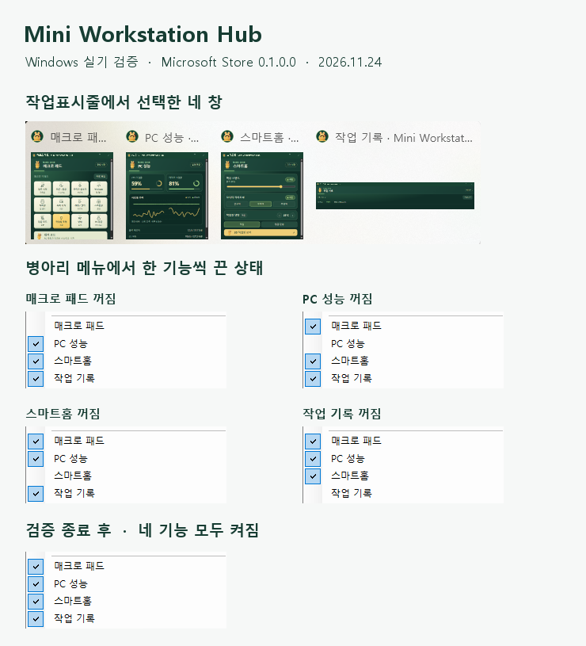

# Mini Workstation Hub

작업실에서 자주 쓰는 **매크로 패드, PC 성능, 스마트홈, 작업 기록**을 네 개의 독립된 Windows 창에 띄우는 데스크톱 앱입니다. PC 성능 창은 이 컴퓨터의 측정값을 보여 줍니다. 매크로와 스마트홈 버튼은 가상 작업실의 조명·냉방·작업 기록이 함께 반응하는 시연을 제공합니다.

## 소스 이용 안내

이 소스는 포트폴리오로 공개합니다. 채용·도입 검토자는 내부 평가를 위해 로컬에서 빌드하고 실행할 수 있습니다. 자체 코드나 수정본의 재배포·제품화·판매에는 feed-mina의 사전 서면 허락이 필요합니다. [포트폴리오 평가용 라이선스](LICENSE.md)

외부 구성요소는 각각의 라이선스를 따릅니다. 여기에는 D3, Three.js, Lucide와 Feather 유래 아이콘, GSAP, WebView2가 포함됩니다. [제3자 라이선스 고지](licenses/)

## Microsoft Store에서 설치

**[Mini Workstation Hub 다운로드 · Microsoft Store 비공개 테스트](https://apps.microsoft.com/detail/restricted/9P7W7FZV2141)**

배포 버전은 **0.1.0.0**이며 Windows 10 빌드 19041 이상 및 Windows 11의 **x64** PC를 지원합니다.

1. Windows의 **Microsoft Store 앱**에 비공개 테스터로 등록된 개인 Microsoft 계정으로 로그인합니다.
2. 위 링크를 열고 **Microsoft Store 앱에서 보기**를 선택합니다.
3. Store에서 앱을 설치하고 **열기**를 누릅니다. ‘제품이 존재하지 않습니다’가 뜨면 Store 오른쪽 위 프로필에서 로그인한 계정이 테스터 계정과 일치하는지 확인합니다.

## 네 창으로 할 수 있는 일

| 창 | 버전 0.1.0.0의 기능 |
| --- | --- |
| 매크로 패드 | 12개 키의 이름을 편집하고 시연 동작을 실행합니다. **업무 시작**을 누르면 스마트홈 창의 조명이 켜지고 작업 기록에 이벤트가 남습니다. 앱 실행·PC 잠금 키도 이 버전에서는 시연 이벤트로 처리합니다. |
| PC 성능 | CPU와 메모리 사용률, 시스템 드라이브 여유 공간, 네트워크 송수신 속도를 실제로 측정합니다. 창을 최소화하거나 끄면 측정을 멈춥니다. |
| 스마트홈 | 책상 스탠드, 모니터 라이트바, 냉방을 조작하고 **3D 작업실 보기**에서 변화를 확인합니다. Home Assistant와 실제 IoT 기기 연동은 후속 개발 범위입니다. |
| 작업 기록 | 현재 세션의 최근 이벤트 60개를 보여 줍니다. 이 기능을 끄면 수집이 멈추고 기록이 비워집니다. |

## 창과 병아리 메뉴 사용법

- **배치**하려면 각 창의 제목 표시줄을 마우스로 끕니다. 창의 위치와 크기는 다음 실행에도 유지되며, 모니터 구성이 바뀌면 화면 안에 맞춥니다.
- **잠시 접어 두려면** 제목 표시줄의 **−**를 누릅니다. 작업표시줄에서 Mini Workstation Hub 아이콘을 선택한 다음 원하는 창의 미리보기를 클릭하면 그 창이 복원됩니다.
- **기능을 끄거나 켜려면** 작업표시줄 오른쪽 **⌃ 숨겨진 아이콘** 안의 병아리를 클릭합니다. 메뉴의 체크를 해제하면 해당 창이 닫히고, 다시 체크하면 열립니다. Windows 설정에 따라 병아리가 작업표시줄에 직접 보일 수도 있습니다.
- 네 창을 모두 꺼도 병아리 메뉴는 남습니다. 메뉴에서 **켜진 창 모두 복원**, **창 위치 정리**, **작업실 종료**를 선택할 수 있습니다.

### Windows에서 확인한 동작

2026년 11월 24일, Microsoft Store 서명본을 설치한 PC에서 네 창을 하나씩 이동하고 최소화한 뒤 실제 작업표시줄 미리보기로 복원했습니다. 병아리 메뉴에서는 각 기능을 껐다 켜며 체크 표시와 해당 창이 함께 바뀌는지 확인했습니다. 두 시험 모두 나머지 세 창의 위치와 최소화 상태는 유지됐습니다.



## 소스에서 빌드

Windows x64에서 .NET Framework 4.8과 PowerShell을 사용합니다. 앱 화면을 표시하려면 Microsoft Edge WebView2 Runtime이 필요합니다. 저장소 루트에서 다음 명령을 실행합니다.

```powershell
.\build.ps1
```

처음 빌드할 때 스크립트가 공식 NuGet에서 WebView2 SDK 1.0.2903.40을 받아 SHA-256을 확인합니다. 빌드 결과는 `dist/WorkstationHub.exe`와 같은 폴더의 UI·라이브러리 파일입니다. 이 개발 빌드는 서명되지 않으며, 위 Store 링크는 Microsoft가 서명한 테스트 버전을 제공합니다.

| 위치 | 내용 |
| --- | --- |
| 루트의 C# 파일 | Windows Forms 창, 알림 영역 메뉴, 성능 측정 및 설정 저장 |
| [ui/](ui/) | WebView2 화면, 매크로 키, 성능 그래프, 3D 작업실 및 프런트엔드 라이브러리 |
| [tests/](tests/) | 별도 임시 프로필로 창 최소화·복원, 메뉴 전환, 창 배치 저장과 재시작을 검사하는 Windows 테스트 |
| [packaging/](packaging/) | Store 버전의 MSIX 매니페스트와 패키지 아이콘 |
| [licenses/](licenses/) | WebView2, GSAP, D3, Three.js, Lucide 배포 고지 |

개발 빌드를 실행할 수 있는 Windows 환경에서 `.\tests\test-windows.ps1`을 실행하면 테스트 결과와 화면 캡처가 저장된 임시 폴더를 확인할 수 있습니다.
