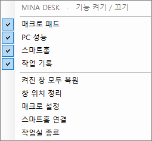
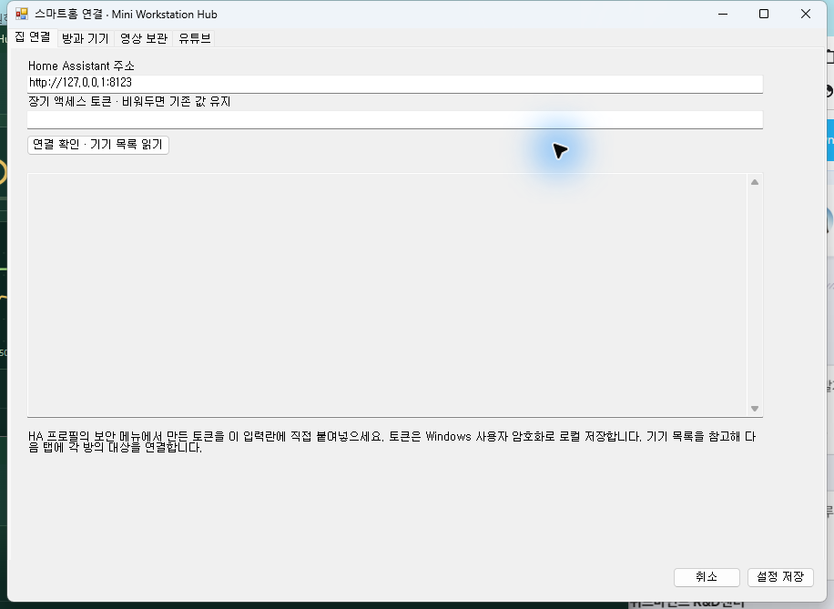

# Store 0.3 설치·Windows UI Automation 검증

2026-11-24 Asia/Seoul. Mini Workstation Hub 0.3.0.0을 이 PC의 Microsoft Store에서 업데이트하고, 실제 설치본으로 창과 병아리 메뉴를 확인했습니다.

1. 기존 0.2 제출은 유지했고, 별도 비공개 0.3 플라이트의 심사 통과·게시 진행을 확인했습니다.
2. Store 서명 0.3.0.0 설치 후 네 창 이동, 하나씩 최소화·작업표시줄 복원, 기능별 끄기·켜기를 확인했습니다.
3. 스마트홈 연결 창을 열었습니다. 실제 기기와 유튜브 시험은 사용자의 계정 연결 뒤 진행합니다.

## 설치 확인

| 항목 | 결과 |
| --- | --- |
| 제품 | Mini Workstation Hub · 9P7W7FZV2141 |
| 비공개 플라이트 | Smart Home 0.3 Private · 제출 1152921505702492900 |
| 패키지 | MiniWorkstationHub.MiniWorkstationHub · 0.3.0.0 |
| Windows 설치 상태 | SignatureKind=Store · Status=Ok |
| 기존 0.2 | 취소·교체하지 않음. Submission 2 게시 상태 유지 |
| 업데이트 중 장애 | 0x80073D02: 실행 중이던 기존 0.1 앱을 종료한 뒤 Store ‘다시 시도’로 완료 |

앱 데이터 삭제와 보안 설정 변경은 하지 않았습니다. 승인 화면뿐 아니라 Windows에 등록된 버전과 실제 실행 경로가 0.3.0.0인 것을 확인했습니다. [설치 정보](evidence/Store-0.3-installed.json)

## 실제 UI 검증

| 모듈 | 독립 이동 | 최소화 → 실제 작업표시줄 복원 | 병아리 메뉴 끄기 → 켜기 |
| --- | --- | --- | --- |
| 매크로 패드 | 통과 | 통과 | 통과 |
| PC 성능 | 통과 | 통과 | 통과 |
| 스마트홈 | 통과 | 통과 | 통과 |
| 작업 기록 | 통과 | 통과 | 통과 |

Windows UI Automation으로 대상 창의 위치·최소화 여부를 읽고, 각 시험에서 나머지 세 창의 위치와 최소화 상태가 유지되는지 비교했습니다. 기능을 껐다 켤 때 해당 창이 닫혔다 다시 열리고, 메뉴 체크도 꺼졌다 켜졌습니다.

**작업표시줄 복원의 정확한 범위:** 한 창씩 최소화한 뒤 실제 작업표시줄의 Hub 점프목록에서 앱 항목을 실행했습니다. 앱의 기존 인스턴스가 켜진 창을 복원했고 대상 창은 원래 위치로 돌아왔습니다. 개별 미리보기 썸네일을 선택해 그 창만 앞으로 가져오는 동작은 이번 0.3 시험에서 확인하지 못했습니다. 앞선 썸네일 이름 매칭 시도는 제한 시간 안에 일치 항목을 찾지 못해 중단했으며, 이를 통과로 집계하지 않았습니다.

- [이동 확인 기록](evidence/Store-0.3-moves-uia.json)
- [작업표시줄 복원 기록](evidence/Store-0.3-taskbar-uia.json)
- [병아리 메뉴 기록](evidence/Store-0.3-tray-uia.json)

실제 캡처: [작업표시줄 점프목록](images/Store-0.3-taskbar-jump-list.png), [매크로 끔](images/Store-0.3-hub-menu-off-macro.png), [PC 성능 끔](images/Store-0.3-hub-menu-off-pc.png), [스마트홈 끔](images/Store-0.3-hub-menu-off-home.png), [작업 기록 끔](images/Store-0.3-hub-menu-off-log.png).

## 실제 연결 시험의 현재 위치

병아리 메뉴의 **스마트홈 연결**에서 설치본의 설정 창을 열었습니다. 사용자가 **집 연결 → 연결 확인 · 기기 목록 읽기 → 설정 저장**을 직접 진행하도록 대기합니다. 토큰은 채팅·공개 저장소에 넣지 않습니다.

기기 목록이 읽히면 방과 기기를 연결하고 실제 상태를 먼저 비교합니다. 음악은 Music Assistant와 YouTube Music 재생목록 연결, 방 청소는 청소기와 방 청소 동작 지원을 각각 확인해야 합니다. YouTube 업로드 계정 연결과 음악 서비스 연결은 별개입니다.

영상은 Android에서 U+ 앱으로 한 편을 갤러리에 저장하고 PC 전송 폴더까지 도착하는 경로부터 시험합니다. 실제 집 영상·개인 채널 업로드·청소·음악 재생은 아직 시험하지 않았습니다. 사용자가 기존 Google 데스크톱 연결 파일을 앱에서 선택하고 브라우저에서 승인하는 단계도 남아 있습니다.

## 다음 행동 하나

열어 둔 스마트홈 연결 창에서 사용자가 Home Assistant 연결을 확인하고 저장합니다. 이후 Hub가 실제 기기 목록과 상태를 읽는지 확인합니다.

[비공개 Store 다운로드](https://apps.microsoft.com/detail/restricted/9P7W7FZV2141) · [기존 구현·자동 검사](smarthome-v03-implementation-20261124.md) · [Windows CI](https://github.com/feed-mina/Workstation_Hub/actions/runs/45383053432)
