# Mini Workstation Hub 화면-코드 인수인계 가이드

처음 이 저장소를 맡는 개발자가 **화면의 값 하나에서 시작해 담당 코드, 실제 로직, 저장 파일까지** 따라갈 수 있게 정리한 문서입니다. 사용법 안내가 아니라 유지보수용 설명이며, 각 기능을 *사용자가 누른 것 → 담당 코드 → 처리와 분기 → 저장값 → 화면 결과* 순서로 설명합니다.

## 1. 목적과 읽는 순서

| 항목 | 내용 |
|---|---|
| 대상 소스 | `feed-mina/Workstation_Hub` `main` 브랜치, 버전 0.8.0.0 (`AssemblyInfo.cs`, `packaging/AppxManifest.xml`) |
| 독자 | 제품 배경을 모르는 채로 Windows 데스크톱 앱(C# WinForms + WebView2)을 유지보수할 개발자 |
| 화면 기준 | `docs/handover/images/`의 캡처는 **실제 UI 파일(`ui/desk.html`, `ui/*.js`)을 격리된 브라우저에서 설명용 데이터로 렌더링**한 것입니다. 숫자·프로젝트명·기록 내용은 설명용 예시이며 실제 PC의 측정값이 아닙니다. 트레이(병아리) 메뉴와 작업표시줄 캡처만 Store 설치본의 실제 화면(`docs/2026-11-24/images/`, `docs/images/`)입니다. |
| 읽는 순서 | 2 제품 개요와 전체 구조 → 3 화면 공통 계약 → 4~12 화면별 기능 → 13 저장 구조 → 14 실행·검증·배포 → 15 문제 진단 → 16 검수표 |
| 표기 | 쉬운 뜻을 먼저 쓰고 정확한 식별자는 `코드체`로 옆에 적습니다. 흐름도의 단계 번호와 상세 표의 번호는 같습니다. |

## 2. 제품 개요와 전체 구조

### 2.1 무엇을 하는 앱인가

작업실에서 자주 쓰는 기능을 **여섯 개의 독립된 Windows 창**으로 띄우는 트레이 상주 앱입니다. 창마다 역할이 다르고, 모든 창은 같은 HTML 파일을 `?panel=` 값만 바꿔 띄운 WebView2 화면입니다.

| 창 키 `Hub.Keys` | 창 제목 `Hub.Titles` | 하는 일 | 설명 절 |
|---|---|---|---|
| `macro` | 매크로 패드 | PC 명령 버튼(잠금·음소거·녹화·스크린샷·VS Code·터미널·재생·업로드), 프로젝트 선택, 프로젝트별 스킬 버튼을 AI 데스크톱 앱에 전달 | 5, 6, 7 |
| `pc` | PC 성능 | CPU·메모리·디스크·네트워크 실측, GPU 카운터 | 8 |
| `home` | 스마트홈 | 방별 Home Assistant 기기 제어, 영상 보관·편집·YouTube 비공개 업로드, 3D 작업실 시연 | 9 |
| `log` | 작업 기록 | 앱에서 일어난 일의 기록과 두 PC 간 공유 | 10 |
| `dev` | 개발자 컨트롤 | Codex 요청 준비, GitHub 조회, 로컬 검증, 도구·웹앱·폴더 바로가기, 창 배치·테마 | 11 |
| `widgets` | 보조 위젯 | 시계·달력, Open-Meteo 날씨, AI 사용량·빠른 실행 링크 | 12 |

### 2.2 코드 계층과 역할 관계

네이티브(C#) 쪽이 상태를 소유하고, 화면(JavaScript)은 상태를 받아 그리기만 합니다. 화면은 외부 네트워크에 직접 접근하지 못합니다(`desk.html`의 CSP가 `connect-src 'none'`).

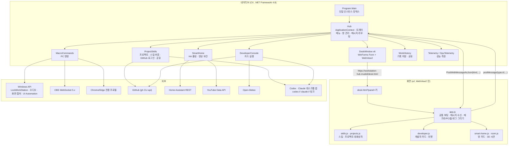

| 핵심 파일 | 역할 (1~2문장) |
|---|---|
| `Program.cs` | 진입점. `Local\MinaDesk.WorkstationHub.v1` 뮤텍스로 두 번째 실행을 막고, 두 번째 실행은 이벤트만 신호해 기존 창을 복원시킵니다. 데이터 폴더는 `%LocalAppData%\MinaDesk\WorkstationHub`입니다. |
| `Hub.cs` | 앱의 중심. 트레이 메뉴, 여섯 창의 열기·닫기·배치·테마, 모든 화면 메시지의 분기(`Receive`), 상태 묶음 전송(`Snapshot`, `Broadcast`), 작업 기록 추가(`AddLog`)를 담당합니다. |
| `DeskWindow.cs` | 창 하나. WebView2를 만들고 `ui/` 폴더를 가상 호스트 `workstation-hub.invalid`로 연결합니다. 다른 주소 이동·새 창·다운로드·권한 요청·개발자 도구를 모두 막고, 화면이 보낸 JSON만 `Hub.Receive`로 넘깁니다. |
| `Settings.cs` | `windows.json`의 창 위치·켜짐 상태·배치(`Layout`)·테마(`Theme`)와 화면 안에 맞추는 계산(`Fit`, `LayoutBounds`). |
| `ui/desk.html` | 여섯 패널과 대화상자의 마크업 전체. 켜진 패널만 `hidden`을 풀어 표시합니다. |
| `ui/app.js` | 공통 부팅(`boot`), 메시지 수신, 매크로 키·PC 성능·스마트홈 시연·작업 기록 그리기. 패널별 추가 스크립트를 필요할 때만 로드합니다. |

### 2.3 시작부터 화면이 뜨기까지

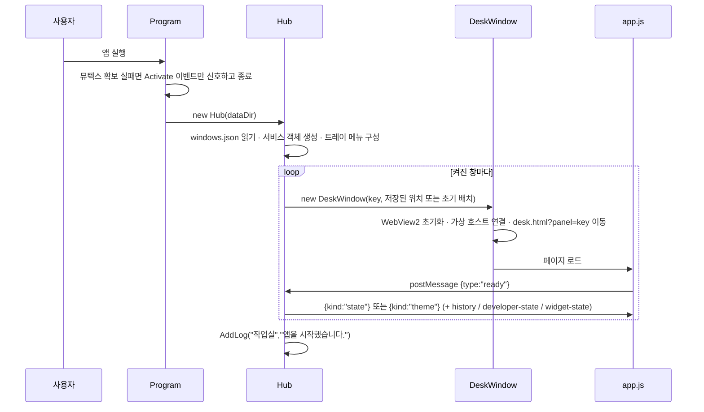

## 3. 화면과 네이티브 사이의 공통 계약

### 3.1 메시지 방향과 형식

| 방향 | 호출 | 형식 | 비고 |
|---|---|---|---|
| 화면 → 네이티브 | `window.chrome.webview.postMessage({type, id, ...})` (`app.js`의 `send`) | `type`이 동작 종류, `id`가 대상 | `Hub.Receive`가 16 KB 초과, 보낸 창 키와 허용 `type`이 맞지 않는 메시지를 무시합니다. |
| 네이티브 → 화면 | `DeskWindow.Send(object)` → `PostWebMessageAsJson` | `kind`로 종류 구분 | 창이 `Ready`가 아니면 보내지 않습니다. |

네이티브가 보내는 `kind` 종류와 소비 위치:

| `kind` | 보내는 곳 | 내용 | 받는 화면 |
|---|---|---|---|
| `state` | `Hub.Snapshot` → `Broadcast`, `Ready` | 버전, 테마, 업무 모드, 시연용 조명 상태 `home`, 스마트홈 `smart`, 매크로 `macro`, 프로젝트·스킬 `skills`, 켜진 창 `enabled` | macro·pc·home·log (`app.js paint`) |
| `theme` | `Broadcast`, `Ready` | 테마 이름만 | dev·widgets |
| `sample` / `gpu-sample` | `Hub` 타이머 | 성능 측정값 | pc |
| `history` | `Hub.SendHistory` | 최근 기록 60개와 공유 상태 | log |
| `notice` | 명령 처리 결과 | 짧은 안내문 | 보낸 창의 `#notice` 영역 (6.5초 뒤 지움) |
| `macro-handoff` | `Hub.ShowMacro` | 개발자 컨트롤에서 열라고 요청한 대화상자 이름 | macro |
| `skills-result` | 스킬·프로젝트 요청 처리 끝 | 처리한 `type` | macro (대기 중 버튼 해제) |
| `developer-state` / `developer-result` | `DeveloperConsole` | 카드 상태 / 카드 실행 결과 | dev |
| `widget-state` | `DeveloperWeather` | 날씨·도시 | widgets |

### 3.2 `Hub.Receive`의 분기 규칙

보낸 창 키(`sender.Key`)와 `type`의 조합이 맞을 때만 처리합니다. 새 메시지를 추가할 때는 이 표에 행을 추가한다고 생각하면 됩니다.

| 보낸 창 | `type` | 처리 | 설명 절 |
|---|---|---|---|
| 모든 창 | `ready` | `Ready(sender)`: 초기 상태 전송, 샘플링 재계산 | 2.3 |
| pc | `gpu-watch` (`id` on/off) | GPU 카운터 읽기 시작·중지 | 8 |
| macro | `macro` (`id`는 `MacroActions` 중 하나) | PC 명령 실행 또는 시연 | 5 |
| macro | `macro-settings`, `account-settings` | 매크로 설정 · 계정 연결 대화상자 | 5 |
| macro | `skills-*`, `skill-*`, `github-*`, `project-*`, `projects-open` | `ProjectSkills.Handle` 후 `skills-result` 회신 | 6, 7 |
| macro | `developer-show` | 개발자 컨트롤 창 열기 | 11 |
| home | `home` (시연 조명), `smart` (HA·영상 보관), `smart-settings` | 시연 상태 변경 / `SmartHome.Execute` / 설정 대화상자 | 9 |
| log | `history-settings` | 공유 폴더 대화상자 | 10 |
| dev | `developer-run`, `developer-choose`, `developer-result-open`, `developer-auto-branches`, `developer-cancel` | `DeveloperConsole.Handle` | 11 |
| widgets | `developer-widget` | `DeveloperConsole.HandleWidget` | 12 |

### 3.3 타이머 한눈에 보기

| 타이머 | 간격 | 조건 | 하는 일 |
|---|---|---|---|
| `Hub.save` | 350 ms 지연 | 창 이동·크기 변경 뒤 | `windows.json` 저장 (연속 이동을 한 번으로 모음) |
| `Hub.sample` | 1.5 초 | PC 성능 창이 열려 있고 최소화가 아닐 때 | `Telemetry.Sample()` 전송 |
| `Hub.gpuTimer` | 6 초 | 위 조건 + GPU 세부 항목을 펼쳤을 때 | `GpuTelemetry.Sample()` 전송 |
| `Hub.instanceTimer` | 0.5 초 | 항상 | 두 번째 실행 신호를 받으면 창 복원 |
| `Hub.historyTimer` | 5 초 | 공유 폴더가 설정됐을 때 | 작업 기록 공유 동기화 |
| `Hub.projectSyncTimer` | 60 초 | GitHub 공유 저장소가 연결됐을 때 | 프로젝트 공유 동기화 |
| `MacroCommands.timer` | 2.5 초 | 매크로 창이 열려 있고 최소화가 아닐 때 | 음소거·OBS 녹화 상태 읽기, 1분마다 해제한 브라우저 프로필 정리 |
| `SmartHome.timer` | 6 초 | 항상 | HA 상태 새로고침, 카메라 수집, 영상 작업 한 단계 |

## 4. S01 창 관리 · 병아리 메뉴 · 배치 · 테마

**핵심 기능** 트레이의 병아리 아이콘 메뉴에서 여섯 기능을 켜고 끄며, 창 위치·배치·테마를 `windows.json`에 기억합니다. 개발자 컨트롤 창의 상단 도구줄에서도 같은 기능을 바꿀 수 있습니다.

실제 화면(Store 0.3 설치본, 네 창 시절): 

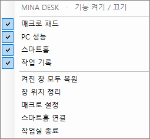

0.8의 메뉴에는 여기에 **개발자 컨트롤, 보조 위젯** 체크 항목과 **창 배치, 테마** 하위 메뉴가 추가돼 있습니다(`Hub` 생성자). 네온 테마의 매크로 패드(실제 UI 파일 렌더링 · 설명용 데이터):

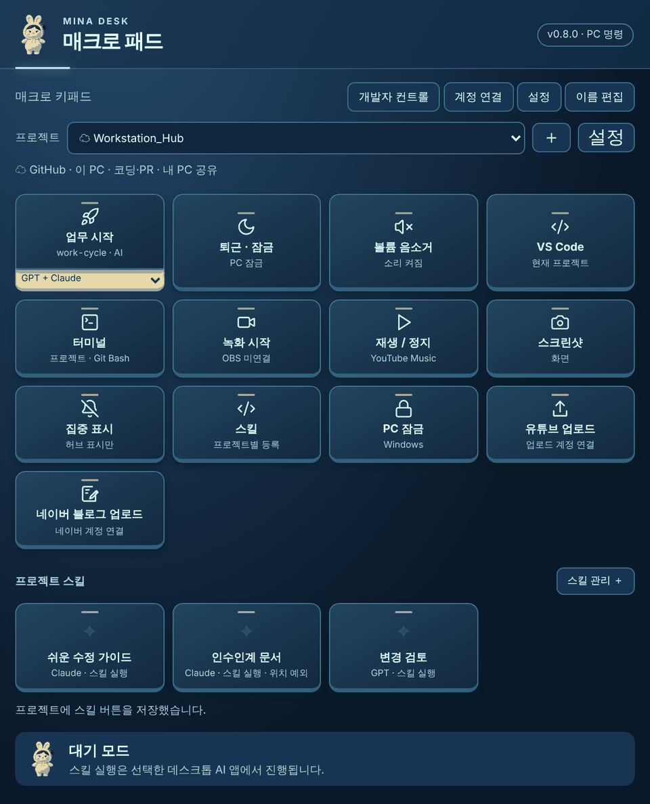

| 핵심 파일·심볼 | 역할 |
|---|---|
| `Hub.Enable(key,on)` | 창 하나를 켜거나 끕니다. 끌 때는 현재 위치를 기억한 뒤 창을 `Dispose`하고, 기록에 "기능 · 켜짐/꺼짐"을 남깁니다. |
| `Hub.ChangeLayout(layout)` | `original`(4창)·`extended`(6창)·`focus`(개발자 모드) 중 하나로 바꾸고, `original`이면 dev·widgets를 끈 뒤 모든 창 위치를 초기 배치로 되돌립니다(`ResetPositions`). |
| `Hub.ChangeTheme(theme)` | `green`·`neon` 전환. 각 창의 제목 표시줄 색(`DeskWindow.ApplyTheme`, DWM 속성 20·35·36)을 바꾸고 화면에는 `theme`를 보내 `body.neon` 클래스를 토글합니다. |
| `Settings.LayoutBounds(area,key,layout)` | 작업 영역 크기와 배치 이름으로 창별 초기 사각형을 계산합니다. 폭 1040 px 미만이면 2열 간이 배치를 씁니다. |
| `Settings.Fit(rect)` | 저장된 위치가 현재 모니터를 벗어나면 화면 안으로 밀어 넣습니다(최소 280×153). |
| `DeskWindow.FormClosing` | 사용자가 X를 누르면 닫지 않고 `Hub.ScheduleClose` → `Enable(key,false)`로 "기능 끄기"로 처리합니다. Windows 종료 때만 앱을 끝냅니다. |

동작 흐름(배치 변경):

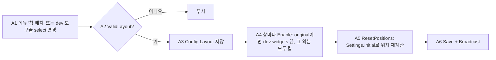

| API·저장 연결 | 실제 내용 |
|---|---|
| 저장 파일 | `windows.json` — `Layout`, `Theme`, `HistoryShare`, `Panels{macro,pc,home,log,dev,widgets}` 각 `Enabled,X,Y,Width,Height`. 임시 파일에 쓴 뒤 `File.Replace`로 교체. |
| 수정 위치·영향 | 창을 하나 추가하려면 `Hub.Keys`/`Titles`, `Settings.IsExtension`·`LayoutBounds`, `desk.html`의 `<section id>`와 `app.js`의 `panels` 목록을 함께 바꿔야 합니다. |
| 수정 후 확인 | 트레이 메뉴 체크 → 창이 열리고 `windows.json`의 `Enabled`가 바뀌는지, 앱 재실행 후 같은 위치로 복원되는지. `tests/test-windows.ps1`(Windows GUI 필요)이 이 회귀를 검사합니다. |

## 5. S02 매크로 패드 · PC 명령 버튼

**핵심 기능** 키 하나를 누르면 화면이 `{type:"macro", id}`를 보내고, 네이티브가 실제 Windows 명령을 실행한 뒤 결과 문구를 `notice`로 돌려주며 작업 기록에 남깁니다. 음소거·녹화 표시등은 2.5초마다 실제 장치 상태를 읽어 갱신합니다.

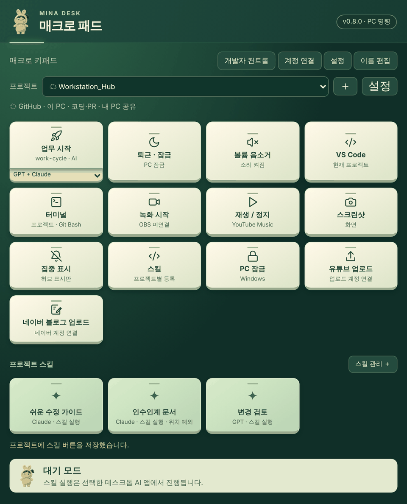

| 번호·영역 | 무엇을 보여주나 | 연결 코드·데이터 |
|---|---|---|
| 상단 배지 `v0.8.0 · PC 명령` | 어셈블리 버전 | `state.version` ← `typeof(Hub).Assembly.GetName().Version` |
| 프로젝트 줄 | 현재 프로젝트와 출처(☁ GitHub)·실행 위치·작업 종류·공유 여부 | `projects.js render` ← `state.skills.projects`, `selectedProjectId` |
| 13개 키 | 이름(편집 가능)·보조 문구·점등 상태 | `app.js definitions`, `paint` ← `state.macro`, `state.active`, `state.mode` |
| 업무 시작 옆 선택 | 업무 시작 때 열 AI 앱 (GPT/Claude/둘 다) | `#start-apps` → `skill-start-apps` → `SkillWorkspaceSettings.StartApps` |
| 프로젝트 스킬 영역 | 현재 프로젝트에 등록한 스킬 버튼 | 7절 |
| 하단 안내 `대기 모드` | 업무 시작·퇴근으로 바뀌는 모드 | `state.mode` (`Hub.mode`) |

업무 시작 후(`mode=업무`, 집중 표시 켜짐, OBS 녹화 중)와 명령 결과 안내가 표시된 상태(설명용):

| 점등 상태 | 결과 안내 |
|---|---|
| 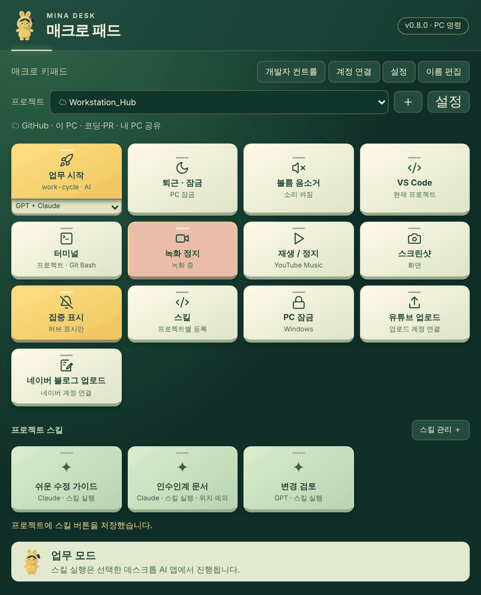 | 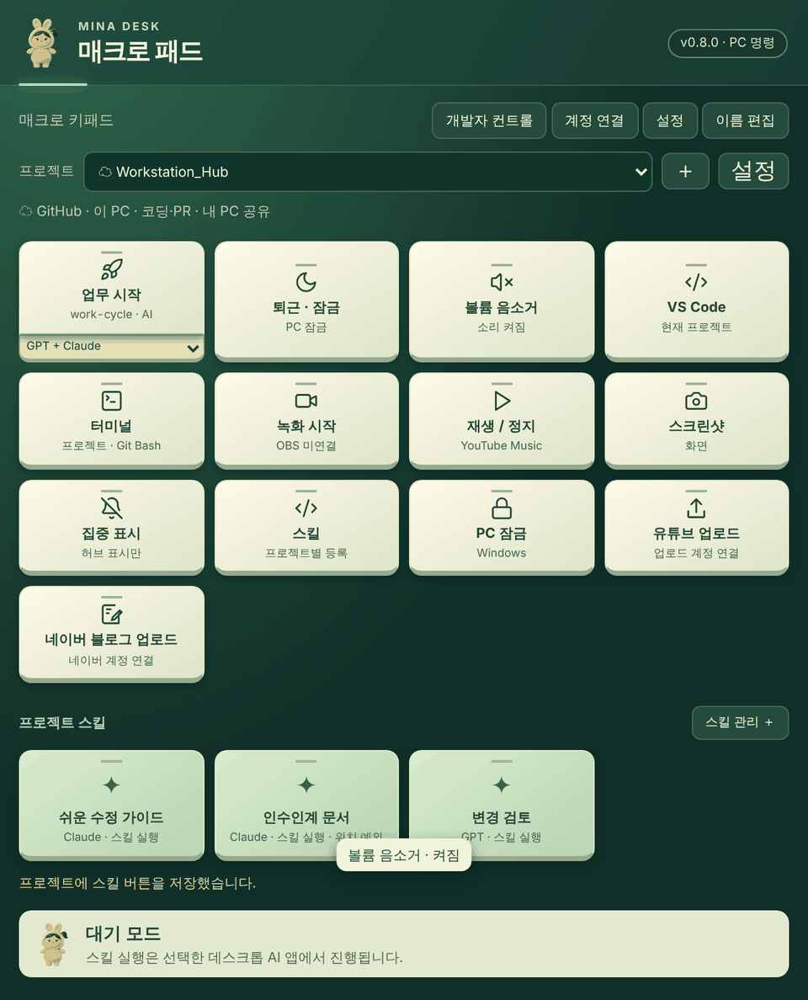 |

### 5.1 키 → 코드 연결

화면 키 ID(`app.js definitions`)는 14개 중 13개가 키패드에 있고, `skills`만 네이티브로 보내지 않고 스킬 대화상자를 엽니다. `light_toggle`·`ac_toggle`은 `Hub.MacroActions`에는 남아 있지만 0.8 키패드에는 키가 없습니다(이전 버전의 시연 동작 ID).

| 키 ID | 화면 기본 이름 | 네이티브 처리 (`Hub.Receive` → ) | 반환 문구·부수 효과 |
|---|---|---|---|
| `pc_lock` | PC 잠금 | `MacroCommands.Execute` → `WindowsCommands.Lock` (`LockWorkStation`) | "PC 잠금 · 요청됨" · 실제 잠금 |
| `work_end` | 퇴근 · 잠금 | `Hub.mode="퇴근"` 후 `Execute("pc_lock")` | 기록 두 줄(매크로, PC 명령) |
| `work_start` | 업무 시작 | `Hub.mode="업무"`, `ProjectSkills.StartApps()` | work-cycle 사이트를 기본 브라우저로, 선택한 AI 앱을 현재 프로젝트로 열기 요청(7.3절) |
| `volume_mute` | 볼륨 음소거 | `SpeakerVolume.Toggle` (Core Audio `IAudioEndpointVolume`) | "볼륨 음소거 · 켜짐/꺼짐", `muted` 갱신 |
| `media` | 재생 / 정지 | 재생 계정이 연결돼 있지 않으면 계정 연결 대화상자, 연결돼 있으면 `BrowserAccounts.Media()` (5.3절) | 연결 프로필의 재생 창 하나에만 `WM_APPCOMMAND` 재생/정지 전송 |
| `record` | 녹화 시작/정지 | `ObsRecorder.ReadOrToggle(settings,true)` | "OBS 녹화 · 녹화 중/정지됨", 실패 시 `recording=null` |
| `screenshot` | 스크린샷 | `WindowsCommands.Screenshot(폴더)` | 전체 가상 화면 PNG 저장 + 클립보드 복사, 경로 반환 |
| `terminal` | 터미널 | `ProjectLauncher.Terminal(ToolFolder)` | Git Bash 우선, 없으면 PowerShell을 프로젝트 폴더(없으면 기본 작업 폴더)에서 |
| `vscode` | VS Code | 프로젝트 폴더가 있으면 `ProjectLauncher.Code(폴더)`, 로컬 폴더 없는 GitHub 프로젝트면 새 창, 프로젝트가 없으면 최근 목록 선택창(`OpenCode`) | 최근 5개는 VS Code의 `state.vscdb`(읽기 전용 SQLite)와 `macros.json`의 `Projects`를 합친 목록 |
| `youtube_upload` / `naver_blog_upload` | 유튜브 업로드 / 네이버 블로그 업로드 | 계정 미연결이면 연결 대화상자, 연결돼 있으면 `BrowserAccounts.Open` | 전용 브라우저로 업로드·글쓰기 주소만 열기 |
| `focus` | 집중 표시 | `Hub.ToggleFocus` | `active` 집합에 `focus` 토글 · 허브 안 표시만 바꿈 |
| `skills` | 스킬 | 화면에서 `projectSkills.open()` | 네이티브 전송 없음 |

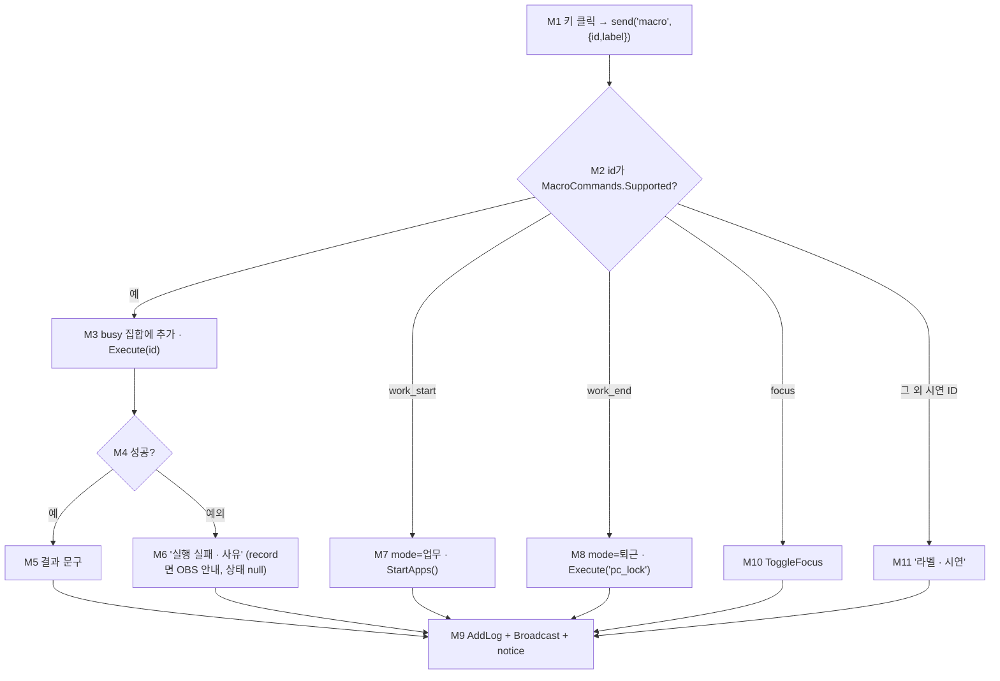

| 단계·담당 함수 | 받는 값 | 처리·조건 | 반환값·부수 효과 | 화면 또는 다음 소비자 |
|---|---|---|---|---|
| M1 `app.js` 키 `onclick` | 키 ID, 현재 표시 이름(`label`, 최대 24자) | 이름 편집 중이면 전송 대신 편집창 열기 | 없음(메시지 전송) | `Hub.Receive` |
| M3 `MacroCommands.Execute(id, owner)` | 명령 ID, 대화상자 부모 창 | `busy`에 이미 있으면 "이미 실행 중입니다." | 결과 문구 `string`; `muted`/`recording` 상태 갱신 | `Hub.Receive` |
| M9 `Hub.AddLog("PC 명령", text)` | 출처, 문구 | 기록 파일 쓰기 실패 시 `historyError` | 없음; `work-history.json` 추가 | 작업 기록 창 |
| `MacroCommands.Refresh()` (2.5초) | 없음 | `SpeakerVolume.Read()`, OBS 상태 읽기(`toggle=false`) | `muted`, `recording` (`bool?`; 읽기 실패면 `null`) | `state.macro.muted/recording` → 키 보조 문구·점등 |

### 5.2 OBS 녹화 연결

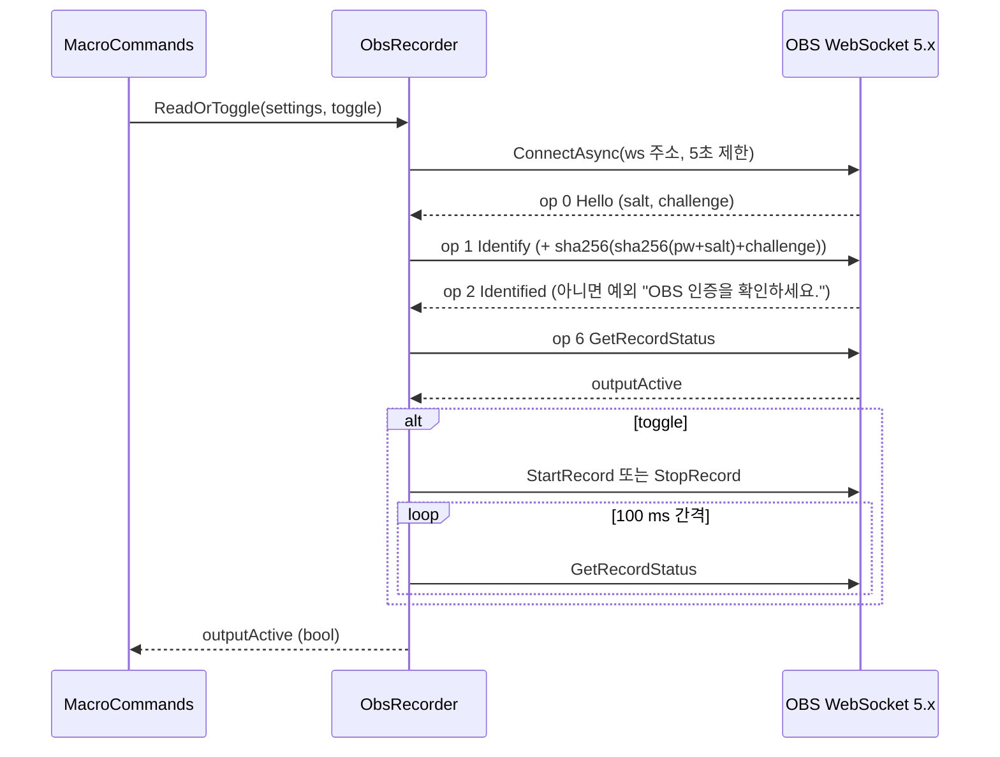

비밀번호는 `MacroSettings.ObsPasswordProtected`에 현재 Windows 사용자 DPAPI로 암호화해 저장하며 화면으로 보내지 않습니다.

### 5.3 재생·업로드 계정(전용 브라우저 프로필)

| 핵심 파일·심볼 | 역할 |
|---|---|
| `BrowserAccounts` | `browser-accounts.json`에 세 서비스(`media`, `youtube_upload`, `naver_blog_upload`)의 프로필 ID·브라우저 경로·별칭·연결 여부와 재생 서비스(`MediaProvider`: youtube/music)를 저장. 해제한 프로필은 `RetiredProfiles`에 넣고 브라우저가 종료된 뒤 폴더를 지웁니다. |
| `AccountBrowser` | Chrome/Edge 설치 경로 후보 검색, `--user-data-dir=<AccountProfiles/프로필ID>`로 전용 창 열기, 같은 프로필의 재생 창 찾기(`TryMedia`). |
| `AccountConnectionsDialog` | WinForms 탭 3개. "전용 브라우저 열기 → 사용자가 직접 로그인 → 로그인 확인 체크 → 연결 완료" 순서. Hub는 비밀번호를 받지 않습니다. |

`TryMedia`는 WMI로 `chrome.exe`/`msedge.exe` 중 명령줄의 `--user-data-dir`가 해당 프로필과 같은 프로세스를 찾고, 그 프로세스의 보이는 창 중 제목에 `YouTube`(또는 `YouTube Music`)가 포함된 창이 **정확히 하나**일 때만 `WM_APPCOMMAND`(재생/일시정지)를 보냅니다. 0개 또는 2개 이상이면 서비스 주소를 새 창으로 열고 사용자가 고르게 합니다.

| API·저장 연결 | 실제 내용 |
|---|---|
| 저장 파일 | `macros.json`(`ScreenshotFolder`, `WorkingFolder`, `CodePath`, `ObsAddress`, `ObsPasswordProtected`, `Projects` 최근 5개), `browser-accounts.json`(+`.bak`), `AccountProfiles/<32자 hex>/` 브라우저 프로필, 프로필 안 `.hub-disconnected` 표식 |
| 화면 설정 저장 | 키 이름은 네이티브가 아니라 WebView의 `localStorage`(`key-names`)에만 저장됩니다. WebView2 사용자 데이터 폴더(`WebView2/`)를 지우면 초기화됩니다. |
| 수정 위치·영향 | 키 추가: `app.js definitions` + `Hub.MacroActions` + (실제 명령이면) `MacroCommands.Supported`와 `Execute`의 `case`. `tests/macro-ui.cjs`가 키 순서(인덱스)로 상태를 검사하므로 순서를 바꾸면 테스트도 수정합니다. |
| 수정 후 확인 | `node tests/macro-ui.cjs` 통과, Windows에서 실제 키 실행 후 작업 기록에 결과 문구가 남는지. |

## 6. S03 프로젝트 등록 · GitHub 로그인 · PC 간 공유

**핵심 기능** 프로젝트는 "이 PC의 폴더" 또는 "GitHub 저장소"로 등록하고, 프로젝트마다 실행 위치(이 PC/클라우드)·작업 종류(코딩/대화)·공유 여부를 저장합니다. GitHub 로그인은 앱에 포함한 공식 GitHub CLI(`gh`)의 웹 인증을 사용하며, 공유는 사용자 계정의 비공개 저장소 `mini-workstation-hub-settings`에 JSON 파일로 올립니다.

| 프로젝트 추가 대화상자 | GitHub 로그인 진행 중 |
|---|---|
| 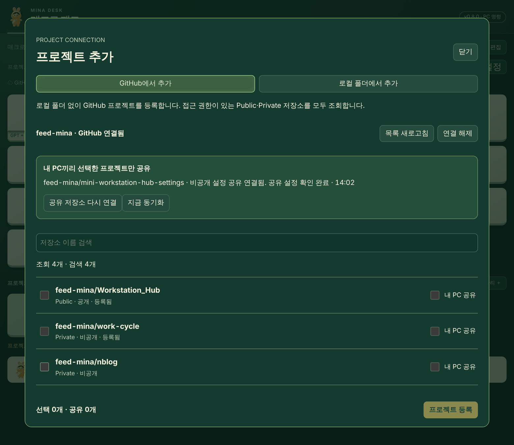 | 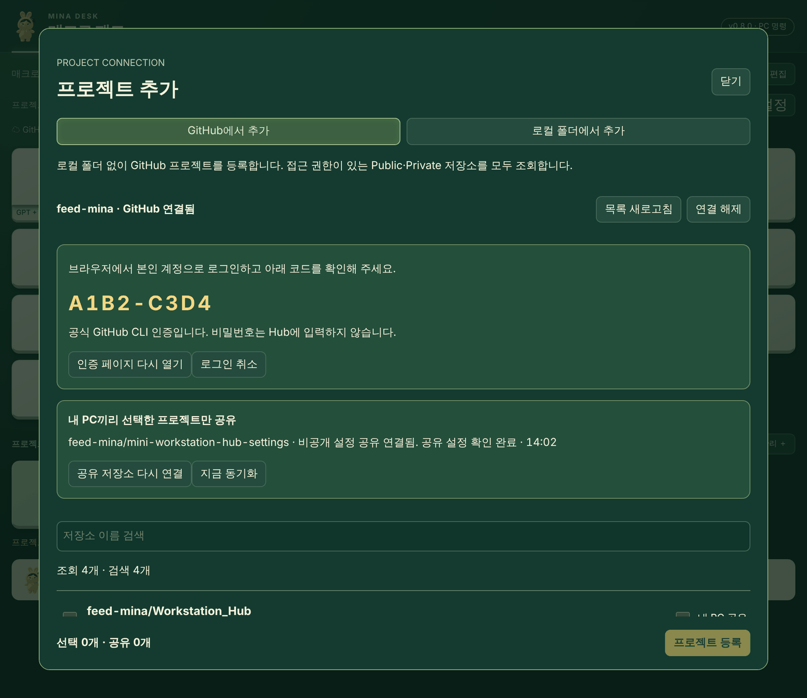 |

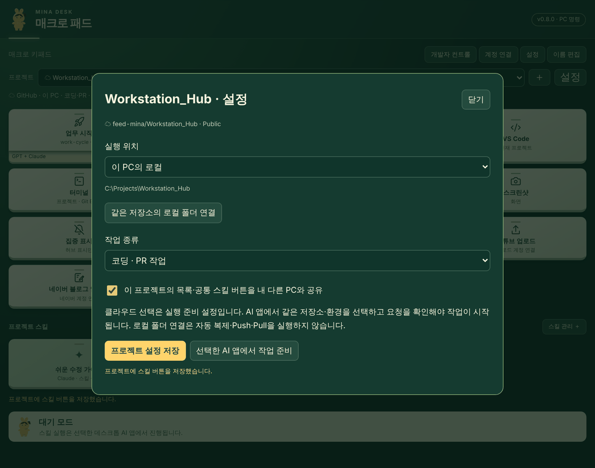

| 번호·영역 | 무엇을 보여주나 | 연결 코드·데이터 |
|---|---|---|
| 계정 줄 `feed-mina · GitHub 연결됨` | 로그인 계정 | `state.skills.github.login/connected` ← `GitHubProjects.LoginName/AccountId` |
| 인증 코드 상자 | `gh auth login` 출력에서 찾은 `XXXX-XXXX` 코드 | `github.authCode` ← `GitHubProjects.Login`의 정규식 `[A-Z0-9]{4}-[A-Z0-9]{4}` |
| 공유 안내 상자 | 공유 저장소 이름과 마지막 동기화 시각 | `github.shareReady/shareRepository`, `syncStatus` |
| 저장소 목록 | 접근 가능한 모든 저장소(100개씩 페이지 조회), 등록 여부, 공유 체크 | `github.repositories` ← `GitHubProjects.ReadRepositories` |
| 프로젝트 설정 | 실행 위치·로컬 폴더·작업 종류·공유·충돌 해결 | `project-config`, `project-bind`, `project-conflict` |

| 핵심 파일·심볼 | 역할 |
|---|---|
| `ProjectSkills` | 프로젝트·스킬·GitHub 관련 모든 화면 요청의 진입점(`Handle`). 상태 묶음(`Snapshot`)을 만들고 `busy` 한 개로 동시 요청을 막습니다. |
| `SkillWorkspaces` | `skill-workspaces.json`의 읽기·검증·원자적 쓰기. 손상 시 `.bak` 복구, 복구도 실패하면 읽기 전용(`ReadOnly`)으로 전환하고 원본을 `.unreadable-<시각>`으로 보존합니다. |
| `GitHubProjects` | `tools/github/bin/gh.exe` 실행 래퍼. 로그인, 사용자 확인, 저장소 목록, 임의 REST 호출(`Send`). `GH_CONFIG_DIR`을 앱 전용 `github-auth/`로 두고 환경 변수의 토큰은 제거합니다. |
| `ProjectSharing` | 공유 저장소 초기화(`Initialize`), 동기화(`Sync`), 가져오기(`Import`), 충돌 해결(`Resolve`). |
| `ui/projects.js` | 두 대화상자의 그리기와 요청 전송. 요청 하나가 끝날 때까지(`pending`) 버튼을 잠급니다. |

### 6.1 GitHub 로그인 흐름

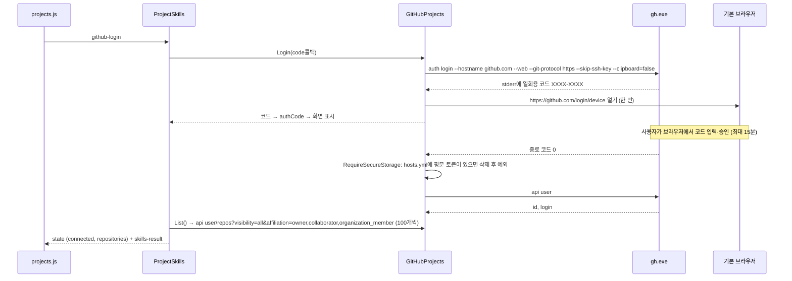

토큰은 `gh`가 Windows 자격 증명 저장소에 보관합니다. `Logout`은 Hub의 `hosts.yml`만 지우고 자격 증명 자체는 **삭제하지 않습니다**(독립 설치한 gh와 공유될 수 있기 때문).

### 6.2 등록·설정 요청과 저장 규칙

| 화면 요청 `type` | 담당 함수 | 받는 값 | 처리·조건 | 저장 결과 |
|---|---|---|---|---|
| `github-register` | `SkillWorkspaces.Register` | `repositoryIds[]`, `shareIds[]` (문자열 ID, 최대 200개) | 목록에 있는 저장소만 허용. `shareIds`는 공유 저장소가 연결된 계정일 때만 | `SkillProject{Id="github-<repoId>", Location="cloud", Repository}` 추가, 선택 프로젝트 변경 |
| `skill-project-add` | `SkillWorkspaces.AddProject` | 폴더 선택 대화상자 결과 | 같은 폴더가 이미 있으면 그 프로젝트를 선택 | `SkillProject{Folder, Location="local"}` |
| `project-config` | `SkillWorkspaces.Configure` | `location`, `taskKind`, `shared` | `local`은 폴더가 실제로 있어야, `cloud`는 Repository가 있어야. 공유 켜기는 GitHub 프로젝트 + 공유 저장소 연결 필요 | `Location`, `TaskKind`, `Shared`, `SharedDirty=true` |
| `project-bind` | `GitHubProjects.LocalOrigin` → `SkillWorkspaces.BindLocal` | 선택한 폴더 | `git config --get remote.origin.url`을 읽어 GitHub `owner/repo`를 뽑고 `repos/<owner>/<repo>`의 `id`가 프로젝트의 저장소 ID와 같을 때만 | `Folder` 연결. 다른 프로젝트가 이미 쓰는 폴더면 중지 |
| `project-conflict` | `ProjectSharing.Resolve` | `choice` remote/local | 6.3절 | |

### 6.3 PC 간 공유 동기화

공유 저장소에는 **프로젝트 목록과 공통 스킬 버튼**만 올라갑니다(`SharedProjectRecord`). 로컬 폴더 경로, 스킬 파일 절대 경로, 실행 위치, 위치별 예외, 로그인 정보는 올라가지 않습니다.

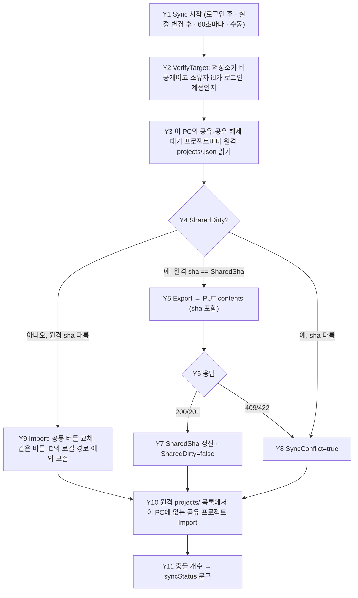

| 공유 키 `ProjectSharing.Key` | 의미 |
|---|---|
| `github-<저장소 id>` | GitHub 프로젝트. 두 PC에서 같은 저장소면 같은 파일을 씁니다. |
| `local-<sha256(프로젝트 Id)>` | 로컬 프로젝트(현재 UI에서는 공유 체크가 GitHub 프로젝트에만 열려 있어 실제로는 생성되지 않지만 코드는 처리합니다). |

| API·저장 연결 | 실제 내용 |
|---|---|
| GitHub REST (모두 `gh api` 경유) | `GET user`, `GET user/repos?...`, `GET repos/{login}/mini-workstation-hub-settings`, `POST user/repos`(비공개 생성), `GET/PUT repos/{full}/contents/workstation-hub.json`(표식: `application=mini-workstation-hub, version=1, accountId`), `GET/PUT repos/{full}/contents/projects/{key}.json`, `GET repositories/{id}` |
| 저장 파일 | `skill-workspaces.json` — `Version=2`, `SelectedProjectId`, `StartApps`, `Projects[]`, `SyncAccountId`, `SyncRepositoryId`, `PendingSync*`. 프로젝트별 `SharedSha`(마지막으로 맞춘 원격 blob sha), `SharedDirty`, `PendingUnshare`, `SyncConflict`, `LocalRegistered` |
| 수정 위치·영향 | 공유 항목을 늘리려면 `SharedSkillButton`/`SharedProjectRecord`, `Export`, `Validate`, `Import`를 함께 바꾸고 `tests/CloudProjectTests.cs`를 갱신합니다. 형식 버전을 올리면 `Validate`가 이전 파일을 거부하므로 양쪽 PC를 함께 업데이트해야 합니다. |
| 수정 후 확인 | `.\tests\test-skills.ps1`(가짜 GitHub API로 등록·바인드·공유·충돌 검사), 실제 계정 두 PC에서 공유 체크 후 상대 PC에 프로젝트가 나타나는지. |

## 7. S04 스킬 버튼 저장과 AI 앱 전달

**핵심 기능** 설치된 스킬(`SKILL.md`)을 골라 프로젝트별 버튼으로 저장하고, 버튼을 누르면 선택한 데스크톱 AI 앱(GPT/Codex 또는 Claude)에 "프로젝트 폴더 + 스킬 파일 경로 + 요청문"을 전달합니다. 로컬 코딩 프로젝트는 공식 링크로 작성창을 연 뒤 **같은 요청문이 입력된 작성창과 전송 버튼을 확인한 경우에만 한 번** 전송하고, 클라우드·대화 프로젝트는 요청문을 보여주고 복사하게 합니다.

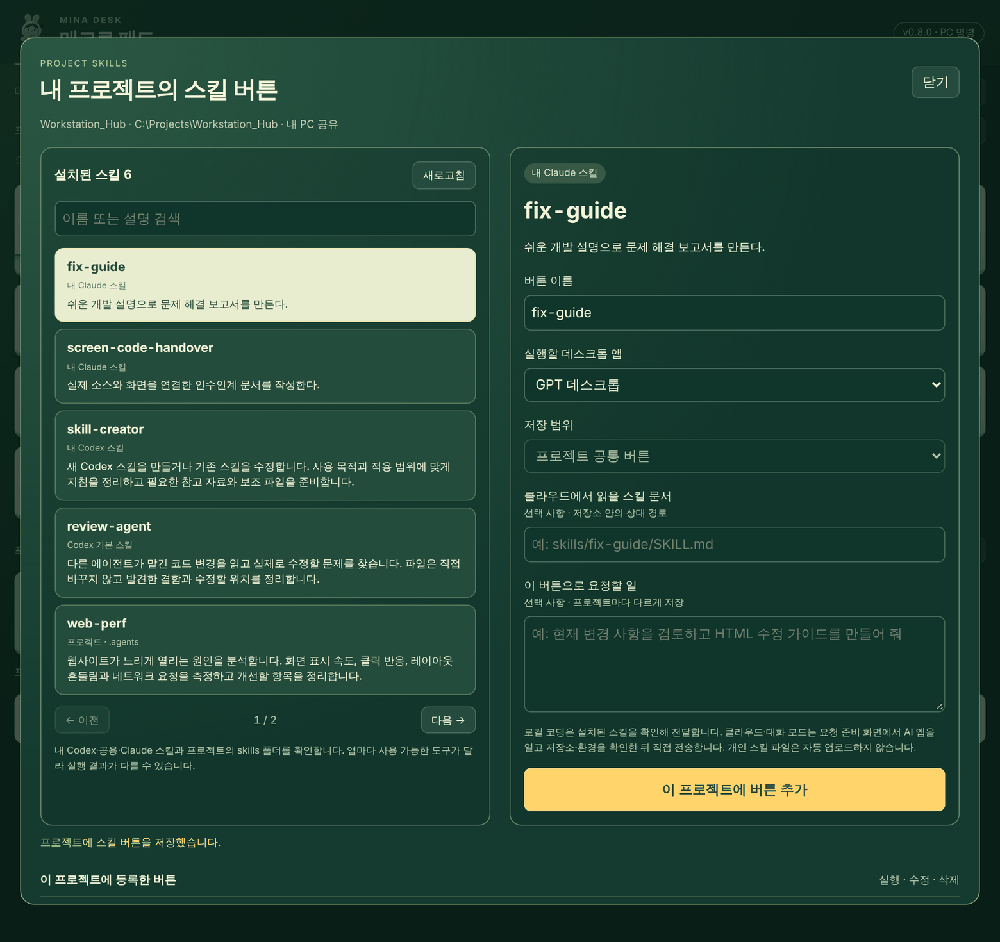

| 번호·영역 | 무엇을 보여주나 | 연결 코드·데이터 |
|---|---|---|
| 왼쪽 "설치된 스킬 N" | 사용자·프로젝트 스킬 폴더에서 읽은 목록, 5개씩 페이지, 이름·설명 검색 | `state.skills.catalog` ← `SkillCatalog.Scan`; 한국어 설명은 `skill-descriptions.ko.js`가 표시용으로만 바꿈 |
| 오른쪽 버튼 설정 | 버튼 이름(1~40자), 실행 앱, 저장 범위(공통/이 PC·현재 위치 예외), 클라우드 스킬 문서 상대 경로(≤500자), 요청문(≤4000자) | `skill-save`, `skill-button-options` |
| 아래 "이 프로젝트에 등록한 버튼" | 실행·수정·삭제·위치 예외 해제 | `state.skills.buttons` ← `SkillWorkspaces.Effective` |

### 7.1 스킬 목록은 어디서 읽나

`SkillCatalog.Scan(userProfile, projectFolder)`가 다음 폴더의 `*/SKILL.md`를 읽습니다. 같은 파일은 한 번만, 이름이 같아도 경로가 다르면 별도 항목입니다. 스킬 ID는 전체 경로(대문자화)의 SHA-256입니다.

| 출처 표시 | 폴더 |
|---|---|
| 내 Codex 스킬 | `~/.codex/skills` |
| Codex 기본 스킬 | `~/.codex/skills/.system` |
| 내 공용 스킬 | `~/.agents/skills` |
| 내 Claude 스킬 | `~/.claude/skills` |
| 프로젝트 · .agents/.codex/.claude | 프로젝트 폴더부터 Git 루트까지 상위로 올라가며 `<폴더>/.agents|.codex|.claude/skills` (Git 루트가 없으면 프로젝트 폴더만) |

이름·설명은 YAML 머리말(`---` 사이)의 `name:`·`description:`을 `SkillCatalog.Header`가 읽고, 없으면 폴더 이름과 기본 문구를 씁니다. 1 MB를 넘는 파일은 건너뜁니다.

### 7.2 버튼 실행 흐름

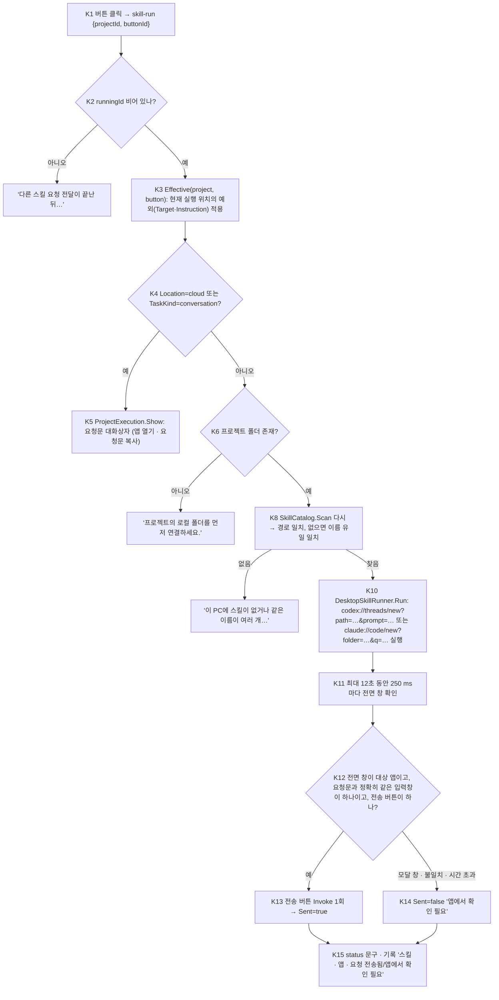

| 단계·담당 함수 | 받는 값 | 처리·조건 | 반환값·부수 효과 | 다음 소비자 |
|---|---|---|---|---|
| K3 `SkillWorkspaces.Effective(p,b)` | 프로젝트, 저장된 버튼 | `Location`이 cloud면 `CloudOverride`, local이면 `LocalOverride`가 있을 때 `Target`·`Instruction`을 덮어씀 | 새 `SkillButton` 복사본 | K4 |
| K5 `ProjectExecution.Prompt(project,button)` | 프로젝트, 버튼(없을 수 있음) | 프로젝트명·저장소 URL·작업 방식·실행 위치·스킬 이름·저장소 안 스킬 문서(`Reference`)·요청문을 줄글로 조립 | 요청문 문자열 → 읽기 전용 텍스트 상자, "요청문 복사" 버튼 | 사용자 |
| K10 `DesktopSkillRunner.Link(target,folder,prompt)` | 대상 앱, 폴더, 요청문 | 길이 30,000자 초과면 예외 | 프로토콜 링크 문자열 → `Process.Start` | AI 앱 |
| K12 `FindComposer` / `FindSend` / `SameDraft` | UI Automation 창 요소 | Edit/Document 요소 중 공백 정규화 후 요청문과 같은 것이 정확히 하나; 그 요소의 상위 4단계 안에서 이름이 Send/전송/보내기 등인 버튼이 정확히 하나 | 요소 또는 `null` | K13 |

`DesktopSkillRunner.Prompt`가 만드는 요청문의 구조(설명용 예시):

```
이 프로젝트에서 'fix-guide' 스킬을 사용해 주세요.
프로젝트 폴더: C:\Projects\Workstation_Hub
스킬 파일: C:\Users\mina\.claude\skills\fix-guide\SKILL.md
먼저 위 SKILL.md를 읽고 지침과 연결된 자료를 따라 주세요. 상대 경로는 스킬 파일 폴더를 기준으로 해석해 주세요.
요청: 현재 변경 사항을 검토하고 HTML 수정 가이드를 만들어 줘
```

### 7.3 업무 시작 버튼이 여는 것

`ProjectSkills.StartApps()`: ① `https://work-cycle.evolvix.workers.dev/`를 기본 브라우저로 열기 요청 → ② 프로젝트가 없으면 안내만 → ③ 클라우드·대화 프로젝트면 요청 준비 대화상자 → ④ 로컬 프로젝트면 `StartApps` 선택(gpt/claude/both)에 따라 `codex://threads/new?path=폴더` 또는 `claude://code/new?folder=폴더`를 요청문 없이 엽니다.

| API·저장 연결 | 실제 내용 |
|---|---|
| 저장 파일 | `skill-workspaces.json`의 `Projects[].Buttons[]` — `Id`, `SkillPath`(이 PC 절대 경로), `SkillName`, `Label`, `Target`, `Instruction`, `Reference`, `LocalOverride{Target,Instruction}`, `CloudOverride{…}` |
| 외부 연결 | `codex://`, `claude://` 프로토콜(앱 미설치면 `Process.Start` 예외 → "확인 필요" 문구). UI Automation(`System.Windows.Automation`)은 읽기와 버튼 1회 호출만 사용. |
| 수정 위치·영향 | 요청문 형식: `DesktopSkillRunner.Prompt`(로컬) · `ProjectExecution.Prompt`(클라우드/대화). 전송 버튼 이름 추가: `DesktopSkillRunner.IsSendName`. 대상 앱 프로세스 이름: `IsAppProcess`(Claude / ChatGPT·Codex). |
| 수정 후 확인 | `.\tests\test-skills.ps1`(`ProjectSkillTests.cs`: 저장·복구·링크 형식·전송 보호 검사). 실제 전송은 Windows에서 AI 앱을 설치한 뒤 버튼을 눌러 작성창 내용과 1회 전송을 눈으로 확인합니다. |

## 8. S05 PC 성능

**핵심 기능** PC 성능 창이 보이는 동안 1.5초마다 CPU·메모리·시스템 드라이브·네트워크를 실측해 보내고, 화면은 최근 60초를 꺾은선으로 그립니다. GPU 항목은 사용자가 "GPU · 온도 센서"를 펼쳤을 때만 6초마다 WMI 성능 카운터를 읽습니다. 온도는 센서 연결 기능이 없어 항상 "센서 연결 필요"입니다.

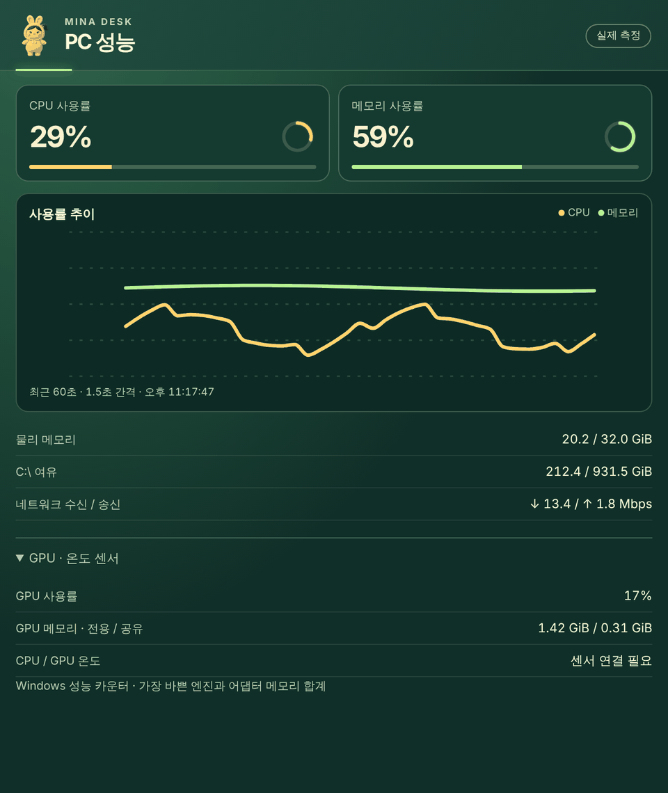

| 번호·영역 | 무엇을 보여주나 | 연결 코드·데이터 |
|---|---|---|
| CPU 사용률 % · 원형 게이지 · 막대 | 두 표본 사이의 비유휴 시간 비율 | `sample.cpu` ← `Telemetry.Sample` (`GetSystemTimes`) |
| 메모리 사용률 % | (전체−여유)/전체 | `sample.ram` ← `GlobalMemoryStatusEx` |
| 사용률 추이 | 최근 60초 CPU(노랑)·메모리(연두) 선, 25% 간격 점선 | `app.js sample()` d3 `line`, `chartHistory` |
| 물리 메모리 | 사용 GiB / 전체 GiB | `usedGb`, `totalGb` |
| `C:\ 여유` | 시스템 드라이브 여유 / 전체 GiB | `driveFree`, `driveTotal`, `volume` |
| 네트워크 수신 / 송신 Mbps | Up 상태 NIC(루프백·터널 제외)의 바이트 증가량 ×8 ÷ 경과초 ÷ 1,000,000 | `down`, `up` |
| GPU 사용률 | `_luid_`별 엔진 사용률 합 중 최댓값 | `gpu-sample.load` ← `Win32_PerfFormattedData_GPUPerformanceCounters_GPUEngine` |
| GPU 메모리 전용 / 공유 | 어댑터별 `DedicatedUsage`, `SharedUsage` 합(GiB) | `gpu-sample.dedicated/shared` ← `..._GPUAdapterMemory` |
| 상태 줄 | 카운터를 찾았는지 | `gpu-sample.status` |

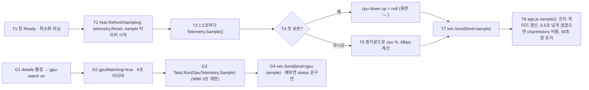

| 단계·담당 함수 | 받는 값 | 처리·조건 | 반환값 | 화면 |
|---|---|---|---|---|
| T3 `Telemetry.Sample()` | 없음(내부 이전 표본 보관) | CPU: `(1 − Δidle/Δtotal)×100`을 0~100으로 자름. 네트워크: NIC ID별 이전 값이 있고 감소하지 않았을 때만 합산, 경과 8초 미만일 때만 속도 계산 | 익명 객체 `{kind:"sample", time(Unix ms), cpu, ram, usedGb, totalGb, driveFree, driveTotal, volume, down, up}` (값은 `double?`) | `#cpu`, `#ram`, `#plot`, `#memory`, `#disk`, `#network` |
| G3 `GpuTelemetry.Sample()` | 없음 | 두 WMI 질의 각각 실패해도 다른 값은 유지 | `{kind:"gpu-sample", load, dedicated, shared, status}` | `#gpu-load`, `#gpu-memory`, `#gpu-status` |
| `Hub.Enable("pc", false)` | | `gpuWatching=false`로 초기화 | | |

| API·저장 연결 | 실제 내용 |
|---|---|
| 저장 | 없음(측정값은 저장하지 않음) |
| 수정 위치·영향 | 측정 항목 추가: `Telemetry.Sample`의 익명 객체 필드 + `desk.html #pc`의 표시 요소 + `app.js sample()`. 간격 변경: `Hub.sample.Interval`과 화면 문구 "1.5초 간격", `chartHistory` 끊김 판정 6.5초. |
| 수정 후 확인 | Windows에서 창을 열어 값이 1.5초마다 바뀌는지, 최소화하면 멈추는지(`tests/DesktopSmoke.cs`가 최소화 중 표본 정지를 검사). |

## 9. S06 스마트홈 · 영상 보관

**핵심 기능** 6초마다 Home Assistant(HA)의 모든 기기 상태와 서비스 목록을 읽어 방별 카드의 버튼을 켜고 끄며, 버튼은 HA 서비스 호출로 이어집니다. 같은 창의 "영상 보관" 카드는 휴대폰 전송 폴더의 영상·사진을 원본 보관 → 날짜별 편집(FFmpeg) → YouTube 비공개 업로드까지 처리합니다. 맨 아래 "작업실 조명 · 3D 시연"은 HA와 무관한 시연 상태(`Hub.studio`)입니다.

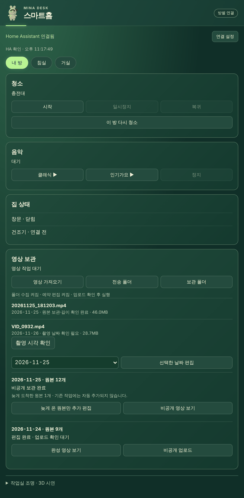

| 번호·영역 | 무엇을 보여주나 | 연결 코드·데이터 |
|---|---|---|
| 상태 줄 `Home Assistant 연결됨` · `HA 확인 · 시각` | 마지막 성공 조회 | `smart.status`, `smart.updatedUtc` ← `HomeAssistantClient.Status/UpdatedUtc` |
| 방 탭 | 설정의 방 목록, 마지막 선택은 `localStorage("smart-room")` | `smart.rooms[]` ← `SmartSettings.Rooms` |
| 청소 카드 | 청소기 상태 문구(`docked`→충전대 등), 시작/일시정지/복귀/이 방 다시 청소 버튼 활성 | `room.vacuum`, `room.start/pause/home/roomClean` ← `ha.Can(entity, 기능 비트)` |
| 음악 카드 | 스피커 상태, 클래식/인기가요/정지 | `room.speaker`, `room.classic/pop/stopMusic` |
| 집 상태 | 창문(열림/닫힘/확인 불가/연결 전), 건조기 | `room.window`, `room.dryer` ← `ha.View` |
| 영상 보관 카드 | 엔진 상태, 가져오기·폴더 열기, 수집·예약·업로드 설정 요약, 원본 목록(최대 40), 날짜 선택 편집, 작업 목록(최대 30)과 작업별 버튼 | `smart.archive` ← `ArchiveEngine.Snapshot`, `smart.watch/daily/autoUpload/youtubeConnected` |

### 9.1 HA 상태 읽기와 버튼 활성 조건

| 버튼 | 필요한 조건 (`HomeAssistantClient`) | 호출하는 HA 서비스 |
|---|---|---|
| 시작 | `Can(vacuum, 8192)` | `vacuum.start` |
| 일시정지 | `Can(vacuum, 4)` | `vacuum.pause` |
| 복귀 | `Can(vacuum, 16)` | `vacuum.return_to_base` |
| 이 방 다시 청소 | `ScriptReady(CleanScript)`: `script.`로 시작하고 `script.turn_on` 서비스 존재 | `script.turn_on` |
| 클래식 / 인기가요 | `Can(speaker, 512)` + `music_assistant.play_media` 서비스 + 재생목록 URI 설정 | `music_assistant.play_media` (`media_type=playlist`, `enqueue=replace`) |
| 정지 | `Can(speaker, 4096)` | `media_player.media_stop` |

`Can`은 마지막 성공 조회가 **20초 이내**이고 기기가 `unavailable`/`unknown`이 아니며 `supported_features` 비트가 켜져 있을 때만 참입니다. 조회가 끊기면 버튼이 자동으로 꺼지고 센서는 "확인 불가"가 됩니다.

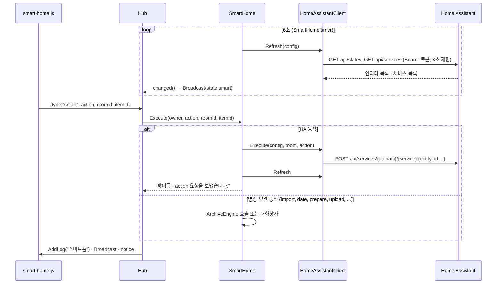

### 9.2 설정 대화상자와 저장값

`SmartSettingsDialog`(WinForms, 4탭: 집 연결 / 방과 기기 / 영상 보관 / 유튜브)가 `smart-home.json`을 편집합니다. 저장 시 검증: 전송 폴더와 보관 폴더가 겹치지 않을 것, 방 이름 1개 이상, `ffmpeg.exe`와 같은 폴더의 `ffprobe.exe` 존재, 자동 영상 작업은 FFmpeg 필수, 자동 업로드는 YouTube 연결 필수, 카메라 수집은 HA 토큰+카메라 필수, 카메라 수집+예약 편집은 사진 10분 모드만.

| 필드 (`SmartSettings`) | 뜻·단위 | 사용 위치 |
|---|---|---|
| `HaAddress`, `HaTokenProtected` | HA 주소(http/https, 쿼리 없음), 장기 토큰(DPAPI 암호화) | 모든 HA 요청 |
| `Rooms[]` (`RoomBinding`) | `Id`(32자 hex), `Name`, `Vacuum`, `CleanScript`, `Speaker`, `Classic`, `Pop`, `Window`, `Dryer`, `Camera` entity_id | 방 카드, 전송 폴더 하위 폴더 이름 |
| `Inbox`, `Archive`, `Ffmpeg` | 전송 폴더, 보관 폴더(`원본/`, `완성 영상/` 생성), ffmpeg 경로 | `ArchiveEngine`, `MediaTools` |
| `WatchFolder`, `DailyJobs`, `AutoUpload`, `CaptureCamera`, `RunHour`, `VideoMode` | 폴더 자동 수집, 전날 예약 편집, 자동 비공개 업로드, 약 6초 카메라 사진 수집, 예약 시각(시), `clips`/`images10` | `ArchiveEngine.Tick`, `SmartHome.Tick` |
| `OAuthClientProtected`, `OAuthTokensProtected` | Google 데스크톱 OAuth 클라이언트 JSON, 액세스·갱신 토큰 (둘 다 DPAPI) | `YouTubeArchive` |

### 9.3 영상 보관 파이프라인

| 핵심 파일·심볼 | 역할 |
|---|---|
| `ArchiveEngine` | 원본 가져오기(`Import`), 카메라 사진 수집(`Capture`), 폴더 감시·예약 편집·작업 처리(`Tick`), 작업 상태 변경(`Prepare`, `Retry`, `UploadNow`, `Resolve`). 원본 영수증은 `archive-receipts.ndjson`에 한 줄씩 추가, 작업은 `archive-jobs.json`에 통째로 저장. |
| `MediaTools` | `ffprobe`로 길이·종류·촬영 시각 읽기(`Probe`), 파일명 `yyyyMMdd_HHmmss`에서 시각 추출, `ffmpeg concat`으로 1280×720 24fps H.264 편집(`Render`). 사진 10분 모드는 결과 길이 600±1초를 검사. |
| `YouTubeArchive` | PKCE 루프백 OAuth(`Authorize`), 토큰 갱신, 재개 가능한 업로드(`Upload`, 8 MiB 조각), 처리·비공개 상태 확인(`Check`). |

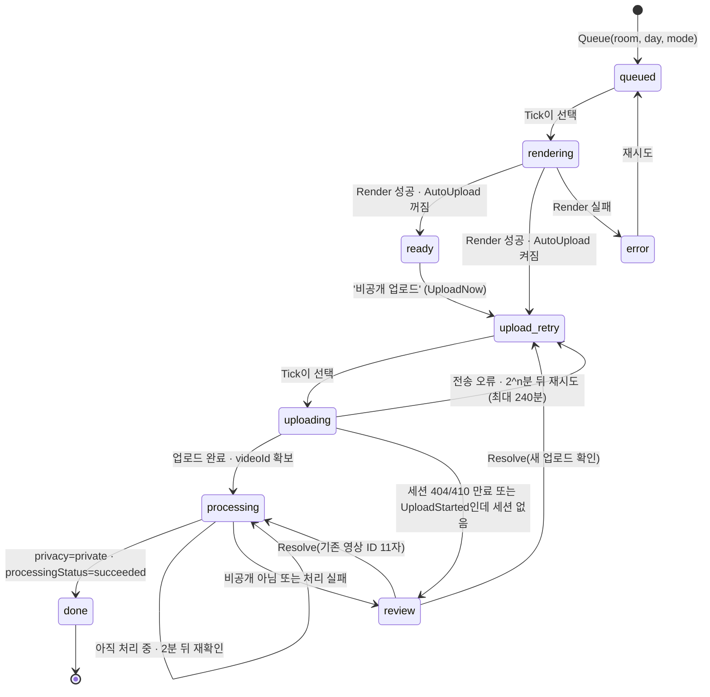

`Import`의 중복 방지: ① 원본 경로+크기+수정시각 키(`SourceKey`)가 이미 있고 보관 파일이 존재하면 건너뜀 → ② 임시 복사 후 SHA-256 → 같은 방에 같은 해시가 있으면 영수증만 추가 → ③ `ffprobe` → 촬영 시각은 `확인값 ?? creation_time ?? 파일명 시각`, 없으면 "촬영 날짜 확인 필요" 상태로 저장(`DateConfirmed=false`).

예약 편집(`DailyJobs`): 현재 시각이 `RunHour` 이후일 때, 날짜가 확정된 원본을 방+날짜로 묶어 **오늘 이전** 그룹만 대상으로 합니다. 같은 방·날짜의 이전 작업이 완료(`done`/`ready`)가 아니거나, 그룹의 마지막 원본이 30분 이내에 들어왔으면 건너뜁니다. 이전 작업에 포함되지 않은 원본만 있으면 "늦게 온 원본" 추가 작업을 만듭니다.

### 9.4 3D 작업실 시연

"작업실 조명 · 3D 시연"의 스탠드·라이트바·냉방·재실·문은 `Hub.studio` 사전(메모리)만 바꾸는 시연이며 어떤 기기에도 연결되지 않습니다. `room.js`가 Three.js로 그리는 방은 대화상자를 열 때만 렌더러를 만들고 닫을 때 자원을 해제합니다. WebGL을 쓸 수 없으면 같은 제어 버튼이 있는 대체 안내를 보여줍니다.

| 펼친 시연 영역 | 3D 대화상자 |
|---|---|
| 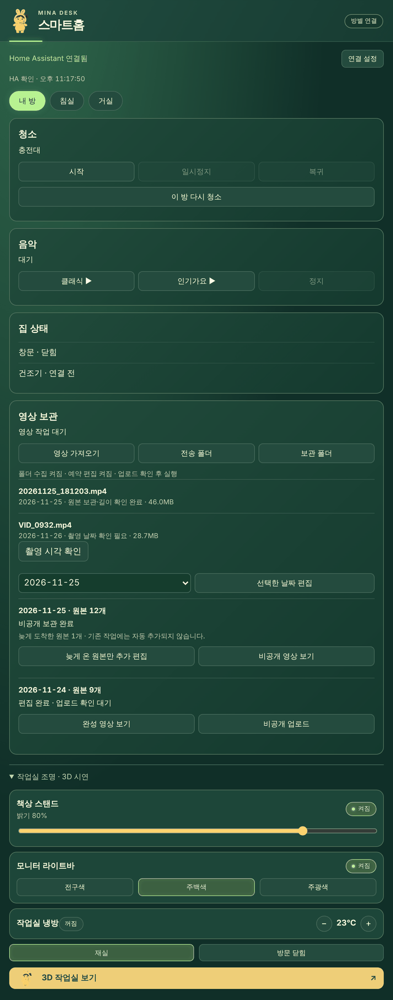 | 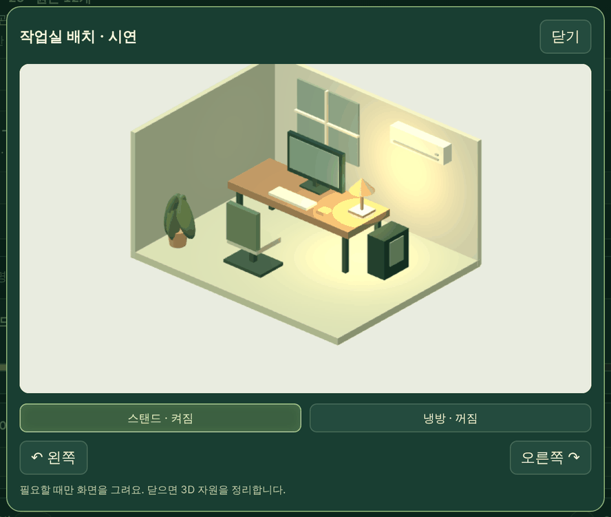 |

| API·저장 연결 | 실제 내용 |
|---|---|
| HA REST | `GET api/states`, `GET api/services`, `POST api/services/{domain}/{service}`, `GET api/camera_proxy/{entity}` (20 MB 제한) |
| Google | `accounts.google.com/o/oauth2/v2/auth`(scope `youtube.upload`, `youtube.readonly`, PKCE S256, 루프백 `127.0.0.1:임의포트`), `oauth2.googleapis.com/token`, `POST www.googleapis.com/upload/youtube/v3/videos?uploadType=resumable`, `PUT 세션 URL`, `GET youtube/v3/videos?part=status,processingDetails` |
| 저장 파일 | `smart-home.json`(+`.bak`), `archive-receipts.ndjson`(손상된 마지막 줄은 `.recovery-*`로 보존 후 잘라냄), `archive-jobs.json`(+`.bak`), `<Archive>/원본/<sha256>.<ext>`, `<Archive>/완성 영상/<jobId>.mp4`, `<Inbox>/<roomId>/` |
| 수정 위치·영향 | 새 HA 동작: `HomeAssistantClient.Execute`의 `case`, `SmartHome.Snapshot`의 방 필드, `smart-home.js render`의 버튼. 편집 규격: `MediaTools.Render`의 ffmpeg 인자. 업로드 메타데이터: `YouTubeArchive.Upload`의 `metadata`(카테고리 22, 비공개). |
| 수정 후 확인 | `node tests/smart-ui.cjs`(버튼 활성·센서 문구·작업 버튼), `.\tests\test-smart.ps1 -Ffmpeg <경로>`(가짜 HA/Google 응답, 생성 영상으로 가져오기·편집·업로드 재개·복구 검사). 실제 기기·채널은 사용자 계정에서 별도 확인. |

## 10. S07 작업 기록

**핵심 기능** 앱 안에서 일어난 일(기능 켜기/끄기, PC 명령 결과, 스마트홈 요청, 스킬 전송, 개발자 카드 결과 등)을 이 PC 파일에 남기고, 네트워크 공유 폴더를 지정하면 다른 PC의 기록과 합쳐 최근 60개를 보여줍니다.

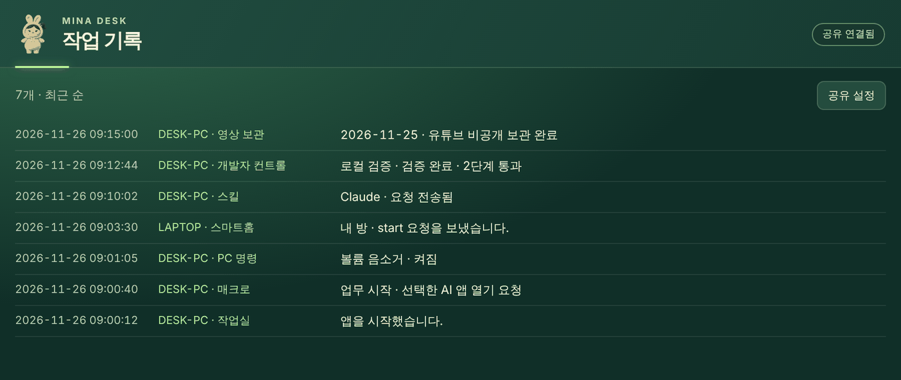

| 번호·영역 | 무엇을 보여주나 | 연결 코드·데이터 |
|---|---|---|
| 배지 `공유 연결됨` | `이 PC` / `공유 연결 확인 중` / `공유 연결됨` / `공유 연결 실패 · 이 PC에는 계속 저장` / 파일 오류 문구 | `history.status` ← `Hub.historyStatus`, `historyError` |
| `N개 · 최근 순` | 표시 중인 행 수 | `app.js addLog` |
| 행 | 현지 시각 · PC 이름 · 출처 · 내용 | `WorkEntry{At(UTC), Pc, Source, Detail}` |
| 공유 설정 | UNC 경로(`\\서버\공유`)만 허용하는 입력 대화상자 | `Hub.ConfigureHistory` → `Settings.HistoryShare` |

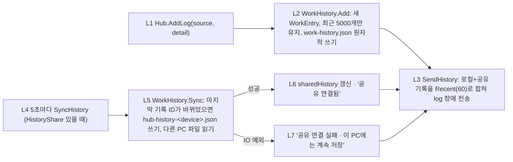

| API·저장 연결 | 실제 내용 |
|---|---|
| 저장 파일 | `work-history.json`(최대 5,000개, +`.bak`), `work-history-device.json`(이 PC의 고정 ID), 공유 폴더의 `hub-history-<deviceId>.json`(이 PC 것은 쓰기 전용, 다른 PC 것은 읽기 전용) |
| 중복·정렬 | `WorkHistory.Recent`: ID로 중복 제거 → 시각 내림차순 → 60개 |
| 수정 위치·영향 | 기록 보존 개수 `WorkHistory.Retention`, 표시 개수 `Recent`의 `Take(60)`과 `app.js addLog`의 60. 새 출처 문구는 `AddLog` 호출부에서 정합니다. |
| 수정 후 확인 | 두 PC에서 같은 UNC 폴더를 지정하고 각 PC에서 명령을 실행했을 때 상대 PC 이름이 붙은 행이 5초 안에 보이는지. `tests/WorkHistoryTests.cs`가 보존·병합 검사 코드를 담고 있지만 별도 `Main`을 가진 독립 파일이며 현재 어떤 테스트 스크립트에서도 호출하지 않습니다(직접 컴파일해 실행해야 함). |

## 11. S08 개발자 컨트롤

**핵심 기능** 다섯 묶음(Codex · GitHub · 도구 · 웹앱 · 폴더)의 카드를 누르면 네이티브가 Codex 요청문 준비, GitHub 읽기 전용 조회, 로컬 검증 스크립트 실행, Windows 도구·사이트·폴더 열기를 수행하고 결과를 아래 결과 영역에 표시합니다. 상단 도구줄은 창 배치·창 표시·테마·바로가기 설정, 그 아래 컨텍스트 줄은 현재 프로젝트·브랜치·실행 위치·공유를 바꿉니다.

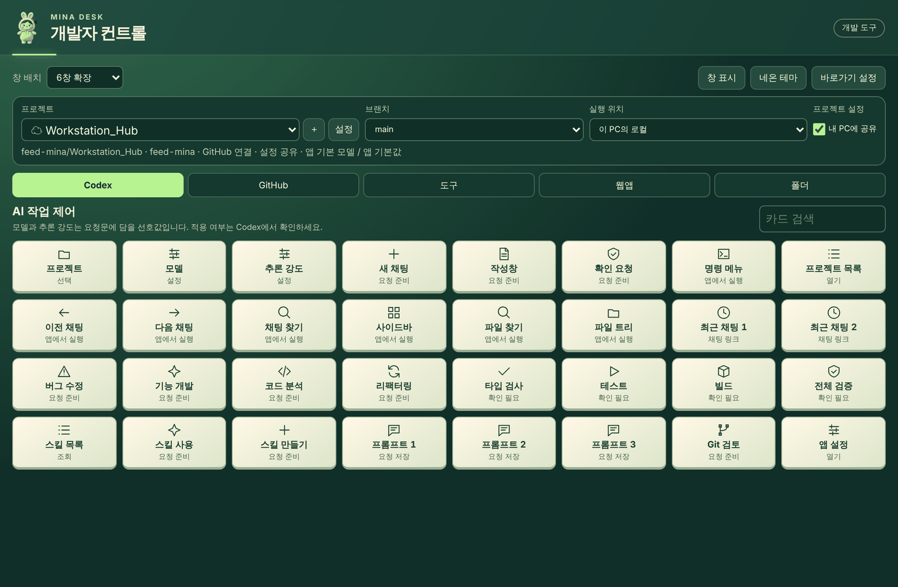

| GitHub 탭과 조회 결과 | 도구 탭 |
|---|---|
| 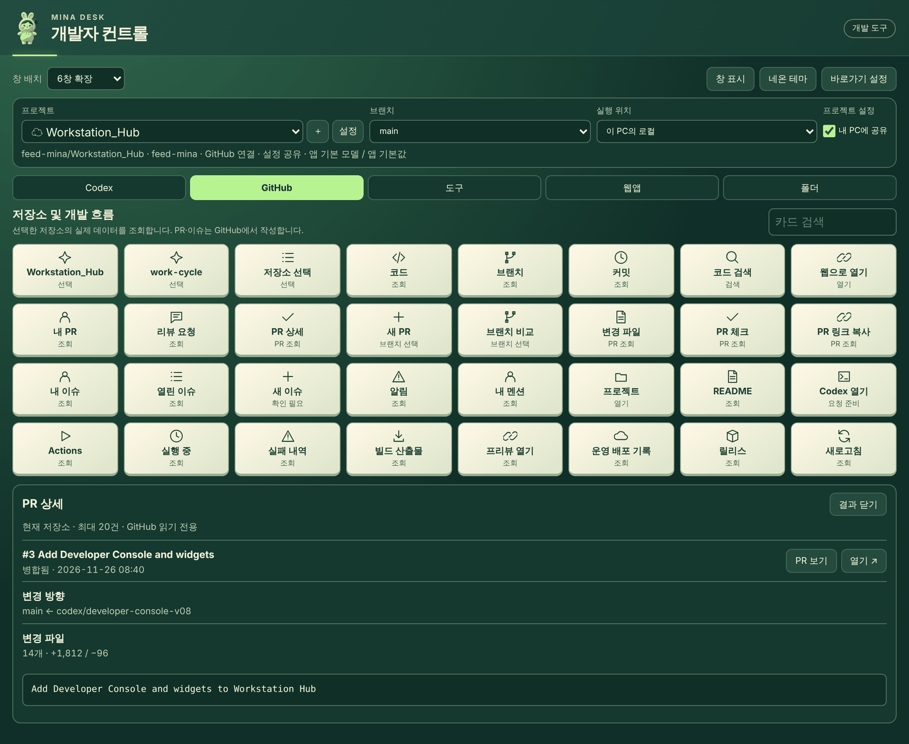 | 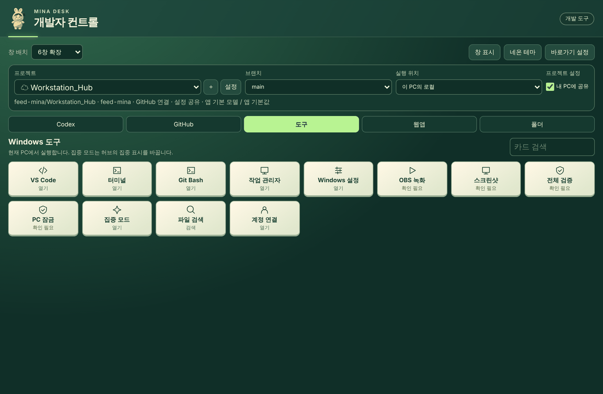 |

| 요청 준비 대화상자 (`draft` 카드) | 바로가기 설정 |
|---|---|
| 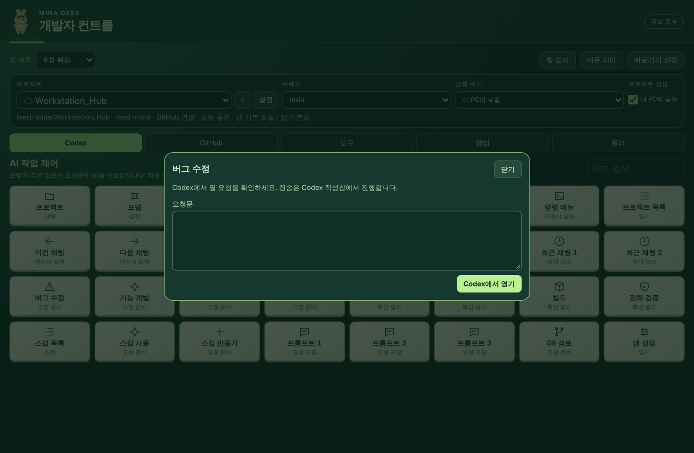 | 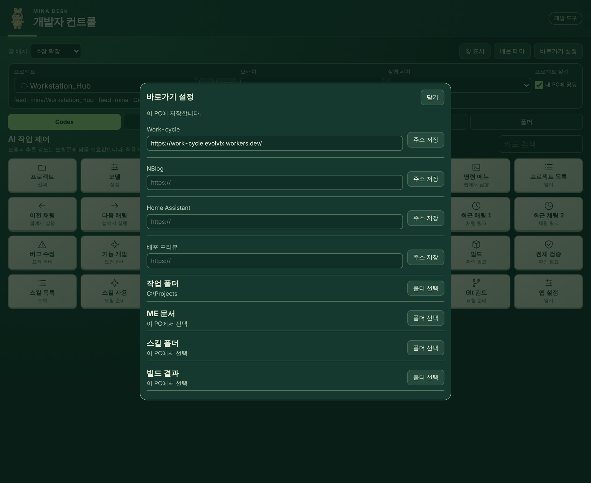 |

| 번호·영역 | 무엇을 보여주나 | 연결 코드·데이터 |
|---|---|---|
| 창 배치 select · 창 표시 · 테마 버튼 | `Hub.ChangeLayout/Enable/ChangeTheme`를 `developer-choose`(id `layout`/`panel`/`restore`/`theme`)로 호출 | `developer-state.layout/theme/enabled` |
| 프로젝트 · 브랜치 · 실행 위치 · 내 PC에 공유 | 프로젝트 선택은 `ProjectSkills`와 공유, 브랜치는 저장소별로 `developer-console.json`에 저장 | `project`, `branches`, `branch`, `shareReady` |
| 컨텍스트 줄 | 저장소 · 계정 · 공유 상태 · 선호 모델/추론 강도 | `developer.js renderState` |
| 카드 | 라벨과 모드 배지(열기/선택/설정/조회/검색/PR 조회/브랜치 선택/확인 필요/요청 준비/요청 저장/채팅 링크/앱에서 실행) | `developer.js groups`, `modes` |
| 결과 영역 | 제목·요약·행(열기 ↗ · PR 보기 · 선택)·본문 | `developer-result` ← `DeveloperResult{title,summary,body,rows[]}` |

### 11.1 카드 모드와 실행 경로

화면의 카드 모드(`developer.js`)는 "무엇을 먼저 물어볼지"를 정하고, 실제 동작은 카드 ID로 `DeveloperConsole.Run`이 분기합니다.

| 화면 모드 | 먼저 하는 일 | 보내는 메시지 |
|---|---|---|
| `open`, `read` | 바로 실행 | `developer-run {id}` |
| `choice` (모델·추론 강도·폴더 설정) | 선택 대화상자 | `developer-choose {id, value}` |
| `draft`, `prompt` | 요청문 입력(스킬 사용 카드는 스킬 선택 포함) | `developer-run {id, value, skill}` / 프롬프트 저장은 `developer-choose` |
| `thread` | 채팅 링크 저장 또는 열기 | `developer-choose` / `developer-run` |
| `search`, `pr`, `compare` | 검색어 · PR 번호 · 기준 브랜치 입력 | `developer-run {id, value}` |
| `confirm` | 네이티브 `MessageBox`로 확인 | `developer-run {id}` |
| `help` | Codex를 열고 단축키 안내 | `developer-run {id}` |

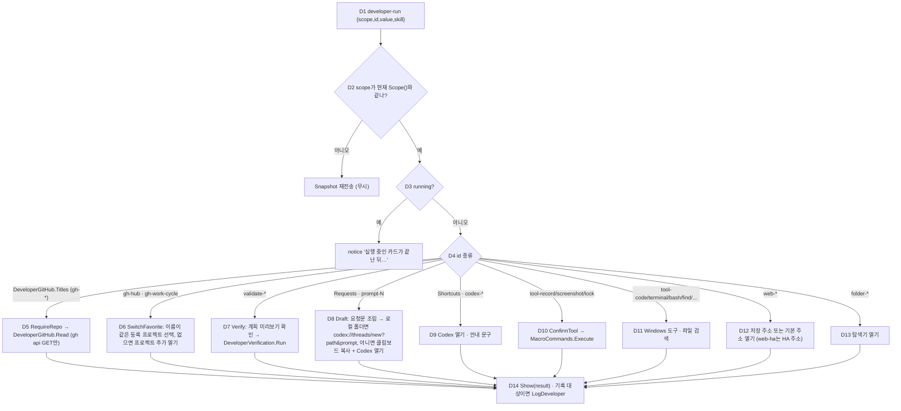

**scope란** `DeveloperConsole.Scope()`는 프로젝트 ID·실행 위치·작업 종류·폴더·저장소 키·브랜치를 이어 붙인 문자열이 바뀔 때마다 새 GUID를 만듭니다. 화면은 받은 `scope`를 모든 요청에 되돌려 보내고, 네이티브는 다른 scope의 요청을 버립니다. 프로젝트를 바꾼 직후 이전 프로젝트용 카드 결과가 적용되는 일을 막기 위한 장치입니다.

### 11.2 GitHub 조회 카드

모두 `DeveloperGitHub.Read(action, repo, login, branch, input, currentPr, cachedBranches, preview)`가 처리하며 `gh api --method GET`만 사용합니다(쓰기 없음). 페이지 크기 20, 브랜치 목록은 100개씩 최대 5페이지.

| 카드 ID | GitHub 경로 | 결과 행 |
|---|---|---|
| `gh-branches` | `repos/{full}` 기본 브랜치 + `/branches` | 브랜치 이름(선택 버튼으로 현재 브랜치 변경) |
| `gh-code` | `/contents?ref=브랜치` | 최상위 파일·폴더 |
| `gh-commits` | `/commits?sha=브랜치` | 짧은 SHA · 제목 · 작성자 · 시각 |
| `gh-search` | `search/code?q=repo:{full} "검색어"` | 파일 경로(기본 브랜치 색인) |
| `gh-my-pr`, `gh-reviews`, `gh-my-issues`, `gh-issues` | `search/issues?q=repo:{full} is:pr author:… / review-requested:… / is:issue assignee:… / is:issue is:open` | #번호 제목 · 상태 · 시각 |
| `gh-pr`, `gh-copy` | `/pulls/{n}` | 제목·병합 여부, 변경 방향, 변경 파일 수, 본문(`body`). `gh-copy`는 링크를 클립보드에 복사 |
| `gh-compare` | `/compare/{기준}...{브랜치}` | 앞선/뒤처진 커밋 수, 변경 파일 25개 |
| `gh-files`, `gh-checks` | `/pulls/{n}/files`, `/commits/{sha}/check-runs` + `/status` | 파일별 증감, 검사별 상태 |
| `gh-notifications`, `gh-mentions` | `/notifications?all=true` | 제목 · 읽음 · 사유 |
| `gh-readme` | `/readme?ref=브랜치` | 본문(최대 30,000자) |
| `gh-actions`, `gh-running`, `gh-failed`, `gh-artifacts` | `/actions/runs?status=…&branch=…`, `/actions/artifacts` | 실행 제목 · 상태 · 브랜치 / 산출물 이름 · 크기 |
| `gh-preview`, `gh-deployments`, `gh-releases` | `/deployments?ref=…` + 각 `/statuses?per_page=1`, `/releases` | 환경 · 상태, 릴리스 |

`gh-new-pr`·`gh-new-issue`는 조회가 아니라 GitHub의 작성 화면(`/compare/기준...브랜치?expand=1`, `/issues/new/choose`)을 확인 후 브라우저로 엽니다. 행의 "열기 ↗"는 `https://github.com` 주소이거나 저장한 프리뷰 주소와 같을 때만 열립니다(`OpenResult`).

### 11.3 로컬 검증 카드

`DeveloperVerification.Plan(action, folder)`는 **로컬 폴더가 연결된 프로젝트**에서만 계획을 만들고, 실행 전에 명령 목록을 `MessageBox`로 보여줍니다.

| 프로젝트 종류 (판별 순서) | 타입 검사 | 테스트 | 빌드 |
|---|---|---|---|
| `package.json`이 있음 | scripts의 `typecheck`/`type-check`/`check:types`/`tsc` 중 첫 번째 | `test` | `build` — 패키지 관리자는 `packageManager` 필드 → `pnpm-lock.yaml` → `yarn.lock` → npm 순 (`<관리자>.cmd run …`을 `cmd.exe /d /c`로) |
| 이 저장소 자신 (`build.ps1` + `Hub.cs` + `tests/test-skills.ps1`) | `build.ps1`(C# 컴파일) | `tests/test-skills.ps1` | `build.ps1` |
| `.sln`/`.slnx` 하나 또는 `.csproj` 하나 | `dotnet build --no-restore` | `dotnet test --no-restore` | `dotnet build --no-restore` |

단계마다 5분 제한, 출력은 24,000자까지 보관, 실패하면 이후 단계를 중지합니다. 결과 행은 "통과"/"실패 · 종료 코드 n"이며 전체 출력이 `body`에 들어갑니다. 취소 버튼은 `developer-cancel` → `taskkill /T /F`.

### 11.4 요청문 준비(Draft)와 저장값

`DeveloperConsole.Draft(id, input, skillId)`가 만드는 줄: 프로젝트 · GitHub 저장소 · 선택 브랜치 · 실행 위치 · (기본값이 아니면) 선호 모델·추론 강도 · (스킬 사용 카드) 스킬 이름과 이 PC의 스킬 문서 경로 · 빈 줄 · 요청문. 로컬 폴더가 있으면 `DesktopSkillRunner.OpenDraft`로 Codex 작성창을 열고(자동 전송 없음), 없으면 클립보드에 복사한 뒤 `codex://`를 엽니다. 모델·추론 강도 목록은 `DeveloperPreferenceStore.Models/Efforts`에 고정돼 있고 요청문에 "앱에서 확인" 문구로만 들어갑니다.

| API·저장 연결 | 실제 내용 |
|---|---|
| 저장 파일 | `developer-console.json`(+`.bak`) — `Version=1`, `Model`, `Effort`, `City`(날씨), `Branches{"계정id/저장소id": 브랜치}`, `Prompts{"프로젝트id/prompt-N": 요청문}`, `Threads{"프로젝트id/codex-recent-N": 채팅 ID}`, `Links{web-*: https 주소}`, `Folders{folder-*: 경로}` |
| 외부 | `gh api`(6절과 같은 세션), `codex://`(루트·`settings`·`threads/new`·`threads/<id>`), `chatgpt://`/`claude://`(대화형 열기 `ProjectExecution.OpenRoot`), `explorer.exe`, `Taskmgr.exe`, `ms-settings:` |
| 수정 위치·영향 | 카드 추가: `developer.js groups`(라벨·아이콘·모드) + `DeveloperConsole.Run`의 분기(또는 `Requests`/`Shortcuts`/`DeveloperGitHub.Titles` 사전). GitHub 조회 추가: `DeveloperGitHub.Titles` + `Read`의 `case`. 검증 규칙: `DeveloperVerification.Plan`. |
| 수정 후 확인 | `.\tests\test-skills.ps1`에 포함된 `DeveloperConsoleTests.cs`(가짜 API로 브랜치·PR·검색·검증 계획 검사), 실제 Windows에서 카드 실행 후 결과 영역과 작업 기록("개발자 컨트롤 · 제목 · 요약"). |

## 12. S09 보조 위젯

**핵심 기능** 이 PC의 시계·월간 달력은 화면 JavaScript만으로 동작하고, 주간 날씨는 네이티브가 Open-Meteo에서 받아 `widget-state`로 보냅니다. AI 사용량과 빠른 실행 버튼은 저장된 주소·앱·폴더를 엽니다.

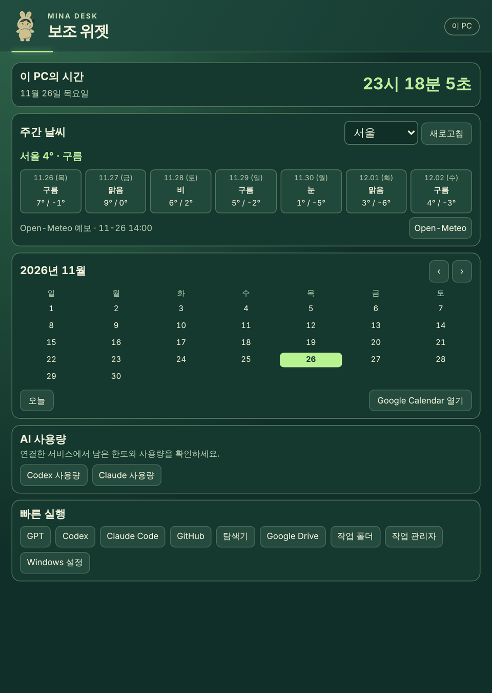

| 번호·영역 | 무엇을 보여주나 | 연결 코드·데이터 |
|---|---|---|
| 이 PC의 시간 | 1초 간격 `toLocaleTimeString('ko-KR')`, 날짜가 바뀌면 달력도 다시 그림 | `developer.js clock()` |
| 주간 날씨 | 도시 8곳 중 선택, 현재 기온·설명, 7일 최고/최저 | `widget-state.city/weather/days/status/updated` ← `DeveloperWeather` |
| 달력 | 월 이동·오늘, 오늘 날짜에 `aria-current` | `developer.js calendar()` (저장 없음) |
| Google Calendar 열기 · AI 사용량 · 빠른 실행 | 주소·앱·폴더 열기 | `developer-widget {id}` → `DeveloperConsole.HandleWidget` |

| 단계·담당 함수 | 받는 값 | 처리·조건 | 반환값·부수 효과 |
|---|---|---|---|
| `DeveloperWeather.Choose(city)` | 도시 이름(목록 밖이면 무시) | `developer-console.json`의 `City` 저장, 이전 예보 비움 | 이어서 `Refresh()` |
| `DeveloperWeather.Refresh()` | 없음 | 마지막 성공 후 5분 이내면 요청하지 않음. `GET api.open-meteo.com/v1/forecast?latitude=…&longitude=…&current=temperature_2m,weather_code&daily=weather_code,temperature_2m_max,temperature_2m_min&timezone=Asia/Seoul&forecast_days=7` (12초 제한) | `current{temperature,description}`, `days[]{date,description,high,low}`; 실패 시 이전 예보 유지 + 30초 뒤 재시도 허용 |
| `Description(code)` | WMO 날씨 코드 | 0 맑음, ≤3 구름, ≤48 안개, ≥95 뇌우, 71~77·≥85 눈, 그 외 비 | 한국어 문구 |

| API·저장 연결 | 실제 내용 |
|---|---|
| 저장 | `developer-console.json`의 `City`만. 예보 자체는 저장하지 않음. |
| 수정 위치·영향 | 도시 추가: `DeveloperWeather.Cities`. 빠른 실행 버튼: `developer.js setupWidgets`의 목록 + `HandleWidget`의 `case`. |
| 수정 후 확인 | 도시 선택 후 상태 줄이 "Open-Meteo 예보 · MM-dd HH:mm"으로 바뀌는지, 네트워크를 끊으면 "날씨 갱신 실패 · 마지막 예보 표시"가 되는지. |

## 13. 저장 구조와 데이터 관계

이 앱에는 데이터베이스 서버가 없습니다. 모든 상태는 **이 PC의 JSON 파일**과 폴더, 그리고 선택적으로 **GitHub 비공개 저장소의 JSON 파일**(프로젝트 공유)과 **네트워크 공유 폴더의 JSON 파일**(작업 기록)에 있습니다. 비밀값은 Windows DPAPI(현재 사용자)로 암호화해 같은 파일에 넣습니다.

### 13.1 저장소별 경계

| 저장 위치 | 파일 | 소유 코드 | 쓰기 방식 | 담는 것 |
|---|---|---|---|---|
| `%LocalAppData%\MinaDesk\WorkstationHub\` | `windows.json` | `Settings` | `.tmp` → `File.Replace` | 창 위치·켜짐·배치·테마·기록 공유 폴더 |
| 〃 | `macros.json` | `MacroSettings` | `.tmp` → `File.Replace` | 스크린샷 폴더, 작업 폴더, Code.exe, OBS 주소·암호(DPAPI), 최근 프로젝트 5개 |
| 〃 | `skill-workspaces.json` (+`.bak`, `.unreadable-*`) | `SkillWorkspaces` | `LocalData.Write` (`.tmp` → `Replace`, 이전본을 `.bak`) | 프로젝트·스킬 버튼·공유 상태·선택 프로젝트·업무 시작 앱 |
| 〃 | `browser-accounts.json` (+`.bak`), `AccountProfiles/<id>/` | `BrowserAccounts` | `LocalData.Write` | 재생·업로드 계정 프로필 연결 |
| 〃 | `github-auth/hosts.yml` 등 | `gh` CLI (`GH_CONFIG_DIR`) | gh가 관리 | GitHub 로그인 메타데이터(토큰은 Windows 자격 증명 저장소) |
| 〃 | `developer-console.json` (+`.bak`) | `DeveloperPreferenceStore` | `LocalData.Write` | 개발자 컨트롤 선호값·링크·폴더·브랜치·프롬프트·도시 |
| 〃 | `smart-home.json` (+`.bak`) | `SmartHome`/`SmartSettingsDialog` | `LocalData.Write` | HA 연결, 방·기기, 영상 폴더, OAuth(DPAPI) |
| 〃 | `archive-receipts.ndjson`, `archive-jobs.json` (+`.bak`) | `ArchiveEngine` | 영수증은 줄 추가(`AppendAllText`), 작업은 `LocalData.Write` | 원본 항목, 편집·업로드 작업 |
| 〃 | `work-history.json` (+`.bak`), `work-history-device.json` | `WorkHistory` | `LocalData.Write` | 기록 5,000개, PC 고정 ID |
| 〃 | `WebView2/` | WebView2 | 브라우저 엔진 | 화면의 `localStorage`(키 이름 `key-names`, 선택 방 `smart-room`) |
| 사용자 지정 폴더 | `<Archive>/원본/`, `<Archive>/완성 영상/`, `<Inbox>/<roomId>/`, `사진\허브\<날짜>\` | `ArchiveEngine`, `MediaTools`, `WindowsCommands` | 파일 | 원본·완성 영상·스크린샷 |
| GitHub 비공개 저장소 `mini-workstation-hub-settings` | `workstation-hub.json`, `projects/<key>.json` | `ProjectSharing` | Contents API `PUT`(sha 조건부) | 공유 프로젝트 목록·공통 버튼 |
| 네트워크 공유 폴더(UNC) | `hub-history-<deviceId>.json` | `WorkHistory.Sync` | PC별 파일 1개 | 작업 기록 공유 |

### 13.2 논리 관계도

JSON 파일 사이에는 데이터베이스 외래키가 없고, 아래 선은 **코드가 ID 값을 비교해 연결하는 논리 관계**입니다.

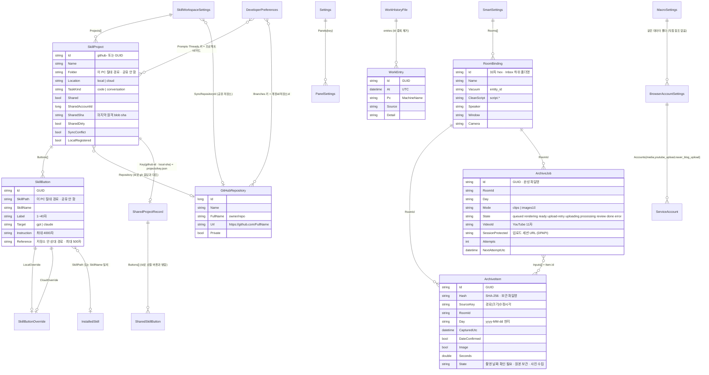

### 13.3 비슷한 이름의 키 구분

| 이름 | 역할 | 변환 |
|---|---|---|
| `SkillProject.Id` | 이 PC의 프로젝트 식별자. GitHub 프로젝트는 `"github-"+저장소 id`로 고정돼 두 PC에서 같음 | 공유 파일 이름 키는 `ProjectSharing.Key(p)`가 다시 계산(`github-<id>` 또는 `local-<sha256(Id)>`) |
| `GitHubRepository.Id` (`long`) | GitHub가 준 저장소 숫자 ID. 화면에는 문자열로 보냄(`id.ToString()`) | 화면이 돌려준 문자열을 `Int64.TryParse`로 복원(`ProjectSkills.Ids`) |
| `InstalledSkill.Id` | 스킬 파일 전체 경로의 SHA-256. 목록 선택에만 쓰고 저장하지 않음 | 저장 시에는 `SkillPath`(경로)와 `SkillName`을 기록하고, 실행 시 경로 → 이름 순으로 다시 찾음 |
| `SharedSha` vs 원격 `sha` | 이 PC가 마지막으로 맞춘 원격 파일의 Git blob sha vs 지금 원격의 sha | 다르면서 이 PC도 바뀌었으면 충돌 |
| `ArchiveItem.Hash` vs `Id` | 내용 해시(중복 판정·보관 파일명) vs 항목 GUID(작업의 `Inputs`가 참조) | 같은 해시가 다른 방에 들어오면 별도 항목 |
| `RoomBinding.Id` | 방 GUID(hex). 전송 폴더 하위 폴더 이름과 영상 항목의 `RoomId` | 방을 삭제해도 기존 항목의 `RoomId`는 남아 화면에서 안 보일 수 있음 |

## 14. 실행 · 변경 · 빌드 · 배포

| 작업 | 실행 위치·환경·설정 | 실제 명령 또는 절차 | 성공 확인 · 실행 여부 |
|---|---|---|---|
| 개발 빌드 | 저장소 루트, Windows x64, .NET Framework 4.8 `csc.exe`, PowerShell. 처음 실행 시 NuGet에서 WebView2 SDK 1.0.2903.40을 받아 SHA-256 확인, `prepare-github.ps1`이 GitHub CLI 2.105.0을 받아 SHA-256 확인 | `.\build.ps1` | `dist\WorkstationHub.exe`와 `dist\ui\`, `dist\tools\github\bin\gh.exe` 생성. 이 문서 작성 환경(Linux)에서는 실행하지 않았습니다. |
| 앱 실행 | `dist\WorkstationHub.exe` 더블클릭. Microsoft Edge WebView2 Runtime 필요 | — | 트레이에 병아리 아이콘, 켜진 창 표시. 화면이 안 뜨면 창 안에 "화면을 준비할 수 없습니다" 안내와 다시 열기 버튼(`DeskWindow.ShowError`) |
| 화면 상태 검사 (Node) | 저장소 루트, Node.js | `node tests/macro-ui.cjs` · `node tests/smart-ui.cjs` | 콘솔에 `PASS …` 출력 (이 환경에서 Node는 있으나 실행은 문서 범위 밖이라 하지 않았습니다) |
| 프로젝트·스킬·계정·개발자 콘솔 단위 검사 | Windows, `csc.exe` | `.\tests\test-skills.ps1` | `ProjectSkillTests.exe`가 `fixtures` 폴더로 실행, 종료 코드 0 |
| 스마트홈·영상 검사 | Windows, FFmpeg 설치 | `.\tests\test-smart.ps1 -Ffmpeg 'C:\경로\ffmpeg.exe'` | 앱을 임시 폴더에 빌드한 뒤 `SmartHomeTests.exe` 실행(가짜 HA/Google 응답, 생성 영상) |
| 창 회귀 검사 | Windows **GUI 세션** | `.\tests\test-windows.ps1` (`-CompileOnly`는 컴파일만) | 임시 프로필로 앱을 띄워 이동·최소화·복원·재시작 검사, 결과 txt와 PNG가 임시 폴더에 |
| 브라우저 UI 검토 | 아무 OS, Python 또는 정적 서버 | `python tests/serve-skill-ui.py` 후 `http://127.0.0.1:8942/desk.html?panel=macro` 또는 `tests/project-preview-bridge.js`를 주입 | PC 명령·AI 전송이 차단된 가짜 브리지로 실제 UI 파일만 렌더링(이 문서의 캡처도 같은 방식) |
| CI | GitHub Actions `windows-2022` (`.github/workflows/windows.yml`), main push·PR | Node 검사 → choco로 ffmpeg 설치 → `test-skills.ps1` → `test-smart.ps1` → `test-windows.ps1 -CompileOnly` | Actions 통과 |
| Store 패키지 | `packaging/AppxManifest.xml`(버전 0.8.0.0, `runFullTrust`, x64, 최소 10.0.19041), 아이콘 `packaging/Assets/` | 저장소에 MSIX 생성 스크립트는 없습니다. `docs/2026-11-24/*.md`에 MakeAppx로 패키지를 만들어 Partner Center에 제출한 기록이 있습니다. | Store 비공개 테스트 링크는 README 참고 |

**변경 지점 요약**

| 바꾸고 싶은 것 | 위치 | 함께 확인 |
|---|---|---|
| 화면 문구 | `ui/desk.html`, 각 `ui/*.js`의 문자열, 네이티브 결과 문구는 해당 `.cs`의 반환 문자열 | `tests/*.cjs`와 `tests/*.cs`가 문구를 비교하는 곳 |
| 새 창 메시지 | `Hub.Receive` 분기 + 보내는 화면 스크립트 | 3.2절 표 |
| 저장 형식 | 각 설정 클래스의 `Version`과 `Load`/`Validate` | 이전 파일 호환(복구 로직이 거부하면 읽기 전용 전환됨) |
| 외부 주소 | `DeveloperPreferenceStore.BuiltInLinks`, `BrowserAccounts.Address`, `ProjectSkills.StartApps`의 work-cycle 주소, `DeveloperWeather.Forecast` | 주소 검증 함수(`CheckWeb`, `AccountBrowser.Open`의 호스트 허용 목록) |

## 15. 문제 진단

| 증상 | 먼저 볼 위치 | 판단 기준 | 조치 |
|---|---|---|---|
| 창은 뜨는데 내용이 없거나 "화면을 준비할 수 없습니다" | 창 안 안내문의 오류 코드, `dist\ui\` 존재, WebView2 Runtime 설치 | `NavigationCompleted` 실패 또는 프로세스 종료(`ProcessFailed`) | Runtime 설치 후 "다시 열기". `WebView2/` 폴더 삭제는 화면 `localStorage`(키 이름)를 초기화함 |
| 두 번째로 실행해도 아무 반응 없음 | 트레이 아이콘 | 뮤텍스가 잡혀 있고 `instanceTimer`가 Activate 신호를 받으면 창을 복원 | 모든 창이 꺼져 있으면 매크로 창부터 켬(`Restore(true)`) |
| 음소거/녹화 표시등이 "상태 확인 대기", "OBS 미연결" | 매크로 설정의 OBS 주소·암호, OBS의 WebSocket 서버 설정 | `Refresh`에서 예외 → `muted`/`recording`이 `null` | OBS 5.x 서버 켜기, 암호 다시 저장(빈 값은 기존 유지) |
| 재생/정지가 서비스 창만 자꾸 엶 | 전용 프로필의 열린 창 수 | 제목에 YouTube(Music)가 있는 창이 정확히 1개여야 전송 | 다른 탭·창을 닫거나 하나만 남김 |
| GitHub 로그인 직후 "Windows 자격 증명 저장소에 … 평문 저장은 중지했습니다" | `github-auth/hosts.yml` | `RequireSecureStorage`가 `oauth_token:` 평문을 발견 | Windows 자격 증명 서비스 확인 후 재로그인. Hub는 평문 토큰을 쓰지 않음 |
| 저장소 목록이 비어 있음 / 조직 저장소가 없음 | 프로젝트 추가의 안내 문구, GitHub 조직 SSO·OAuth 앱 승인 | `user/repos` 응답(401이면 재로그인 문구, 403이면 권한·한도 문구) | 승인 후 "목록 새로고침" |
| 프로젝트 설정에 "다른 PC의 설정과 충돌했습니다" | `skill-workspaces.json`의 `SyncConflict`, 원격 `projects/<key>.json` | 이 PC `SharedDirty=true`이면서 원격 sha가 `SharedSha`와 다름 | "다른 PC 설정 받기" 또는 "이 PC 설정 사용" 선택 → 다음 동기화에 반영 |
| 스킬 버튼이 "이 PC에 스킬이 없거나 같은 이름이 여러 개" | 7.1절 폴더, 버튼의 `SkillPath` | 경로 일치 없음 + 이름 일치가 0개 또는 2개 이상 | 스킬 화면에서 버튼 수정 → 목록에서 다시 선택 후 저장 |
| 스킬 버튼을 눌렀는데 "앱에서 확인 필요" | AI 앱 작성창 | 12초 안에 같은 요청문의 입력창과 전송 버튼을 하나씩 찾지 못함(모달·권한 확인·다른 내용) | 앱에서 직접 확인 후 전송. 자동 전송은 설계상 보수적임 |
| 프로젝트 설정 "읽기 전용", 저장 버튼 비활성 | 데이터 폴더의 `skill-workspaces.json.unreadable-*`, `.bak` | `Load` 검증 실패 + `.bak` 복구 실패 → `ReadOnly` | 보존된 파일을 수정해 되돌리거나 삭제 후 재시작(프로젝트 재등록 필요) |
| 스마트홈 버튼이 모두 비활성, "확인 불가" | 상태 줄 문구, HA 주소·토큰 | `UpdatedUtc`가 20초보다 오래됨 또는 `unavailable` | 연결 설정의 "연결 확인 · 기기 목록 읽기"로 응답 확인 |
| 영상 작업이 `review`에 멈춤 | 작업 행의 상세 문구, YouTube Studio | 세션 만료/비공개 아님/처리 실패 → 중복 업로드 방지로 자동 재시도 중단 | "업로드 결과 확인"에서 기존 영상 ID 입력 또는 새 업로드 확인 |
| 영상 보관 기록 손상 안내 | `archive-receipts.ndjson`, `.recovery-*` | 마지막 줄만 손상이면 자동 절단·보존, 중간 줄 손상이면 예외로 엔진 비활성 | 백업으로 복원 후 재시작 |
| 작업 기록 배지 "공유 연결 실패 · 이 PC에는 계속 저장" | 공유 설정의 UNC 경로, 네트워크 권한 | `Sync`에서 IO 예외 | 경로·권한 확인. 로컬 기록은 계속 저장됨 |
| 날씨 "날씨를 불러오지 못했습니다" | 네트워크, Open-Meteo 응답 | 12초 제한 초과 또는 형식 오류 | 30초 뒤 "새로고침" |

## 16. 검수와 확인 범위

| 기능 | 코드 근거 | 화면·도식 | 입력·결과 | API·저장 연결 | 유지보수 | 검증 결과 |
|---|---|---|---|---|---|---|
| S01 창 관리 | `Hub`, `DeskWindow`, `Settings` | 실제 트레이 캡처 + 네온 렌더링, 배치 흐름도 | 포함 | `windows.json` | 포함 | 정적 분석. Windows 실행은 하지 않음 |
| S02 매크로 | `MacroCommands`, `WindowsCommands`, `ObsRecorder`, `BrowserAccounts`, `app.js` | 렌더링 3장, 흐름도, OBS 순서도 | 포함 | `macros.json`, `browser-accounts.json` | 포함 | 정적 분석 |
| S03 프로젝트·GitHub·공유 | `ProjectSkills`, `SkillWorkspaces`, `GitHubProjects`, `ProjectSharing`, `projects.js` | 렌더링 3장, 로그인 순서도, 동기화 흐름도 | 포함 | GitHub REST, `skill-workspaces.json` | 포함 | 정적 분석 |
| S04 스킬 버튼 | `SkillCatalog`, `DesktopSkillRunner`, `ProjectExecution`, `skills.js` | 렌더링 1장, 실행 흐름도 | 포함 | `codex://`, `claude://` | 포함 | 정적 분석 |
| S05 PC 성능 | `Telemetry`, `GpuTelemetry`, `app.js sample` | 렌더링 1장, 흐름도 | 포함 | 저장 없음 | 포함 | 정적 분석 |
| S06 스마트홈·영상 | `SmartHome`, `HomeAssistantClient`, `ArchiveEngine`, `MediaTools`, `YouTubeArchive`, `smart-home.js`, `room.js` | 렌더링 3장, 순서도, 작업 상태도 | 포함 | HA·Google API, `smart-home.json`, 영수증·작업 파일 | 포함 | 정적 분석 |
| S07 작업 기록 | `WorkHistory`, `Hub.SyncHistory` | 렌더링 1장, 흐름도 | 포함 | `work-history.json`, UNC 공유 | 포함 | 정적 분석 |
| S08 개발자 컨트롤 | `DeveloperConsole`, `DeveloperGitHub`, `DeveloperVerification`, `DeveloperPreferences`, `developer.js` | 렌더링 5장, 분기 흐름도 | 포함 | GitHub REST, `developer-console.json` | 포함 | 정적 분석 |
| S09 보조 위젯 | `DeveloperWeather`, `developer.js` | 렌더링 1장 | 포함 | Open-Meteo | 포함 | 정적 분석 |
| 저장 구조 | 각 설정 클래스 | 논리 관계도 | — | 13.1 표 | 13.3 | 정적 분석 |

- 모든 화면 캡처는 `ui/` 원본을 수정하지 않고, 별도 스크립트가 가짜 `window.chrome.webview` 브리지를 주입해 렌더링했습니다. 실제 Windows 앱 실행, 테스트 스크립트 실행, 빌드는 이 문서 작성 환경에서 수행하지 않았으며 명령과 기대 결과만 안내합니다.
- 코드에 없는 기능(온도 센서, MSIX 생성 스크립트, 자동 Git 복제·Push)은 없는 것으로 표기했습니다.
- 문서의 Mermaid 도식은 GitHub에서 바로 렌더링됩니다. 수정 후에는 GitHub 미리보기에서 깨진 도식이 없는지 확인하세요.
