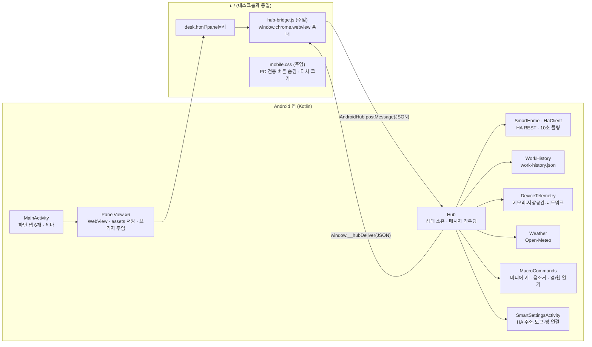
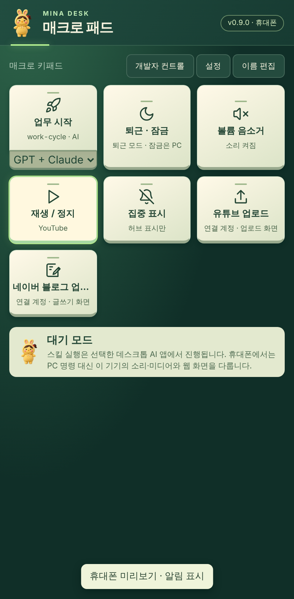
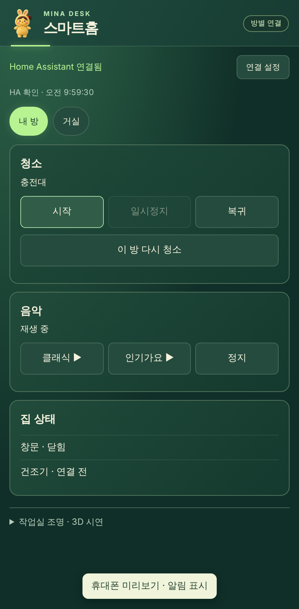
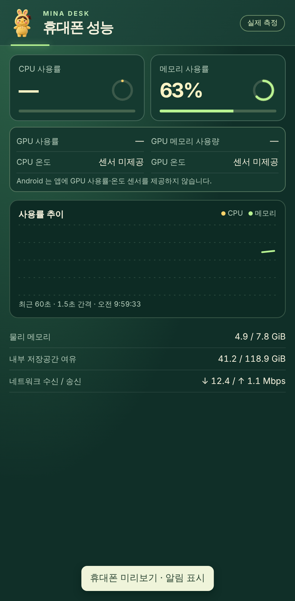
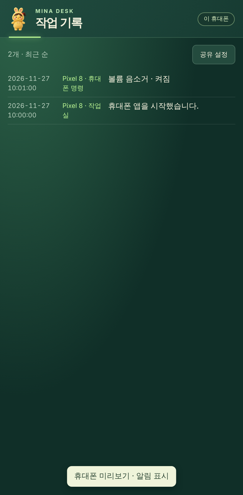
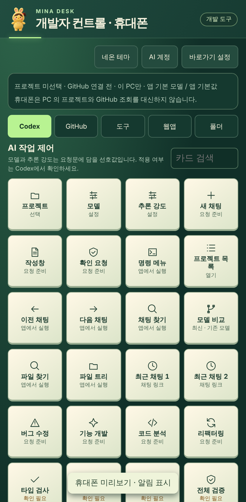
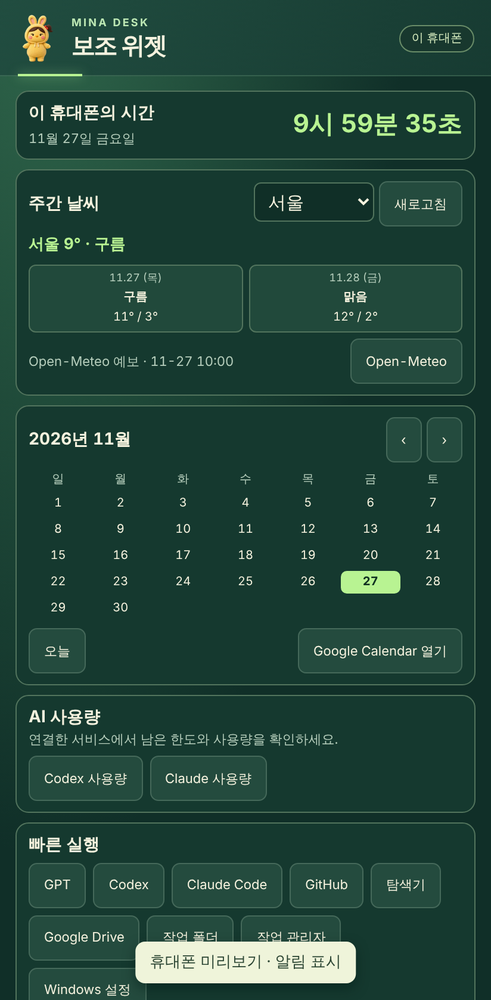

# Mini Workstation Hub · Android 버전 (`mobile` 브랜치)

Windows 허브의 여섯 창을 휴대폰의 **하단 탭 여섯 개**로 옮긴 앱입니다. 화면 파일은 데스크톱과 **같은 `ui/` 폴더**를 그대로 APK 의 assets 로 포함하며(복사본 없음), Kotlin 쪽이 WebView2 호스트 대신 메시지를 받아 처리합니다.

| 항목 | 내용 |
|---|---|
| 소스 | `android/` (Gradle · Kotlin · 외부 라이브러리 없음, Android 프레임워크 API 와 Kotlin 표준 라이브러리만 사용) |
| 지원 | Android 8.0 (API 26) 이상 · targetSdk 36 |
| 패키지 | `com.minadesk.workstationhub` · 버전 0.9.1 · 내부 버전 901 |
| 빌드 | GitHub Actions **Android build** 워크플로가 `mobile` 브랜치 푸시마다 디버그 APK 를 산출물(`WorkstationHub-debug-apk`)로 올립니다. Play용 후보 AAB도 생성합니다. 실제 제출 파일에는 별도 업로드 키 서명이 필요합니다. 로컬은 Android Studio 또는 `cd android && ./gradlew assembleDebug` |
| 검사 | `node tests/mobile-bridge.cjs`, `node tests/mobile-behavior.cjs` · `./gradlew testDebugUnitTest assembleDebug lintDebug` |

## Google Play 배포 준비 (0.9.1)

Android 16 대상 설정과 뒤로가기 대응, 앱 상단의 앱 정보·오프라인 개인정보 안내, 공개 정책 문서, 업로드 키 서명 설정을 추가했습니다. CI는 release AAB·두 빌드 유형 lint·서명 설정 및 Android 11/16 가상 기기 검사를 포함합니다.

[출시 준비와 남은 소유자 확인](google-play-release.md) · [소개문 초안](play-listing.ko-KR.json) · [이미지 초안](play-assets/README.md) · [공개 Android 개인정보 안내](../privacy-android.md)

## 1. 구조

* **브리지** · `PanelView` 가 `https://workstation-hub.invalid/desk.html` 요청을 가로채 `hub-bridge.js` 와 `mobile.css` 를 끼워 넣습니다. 브리지는 WebView2 의 `window.chrome.webview.postMessage / addEventListener('message')` 와 같은 모양을 만들어 `ui/*.js` 를 수정하지 않습니다. CSP(`script-src 'self'`)를 그대로 지키며, 다른 호스트 요청·새 창·다운로드·권한 요청은 데스크톱과 같이 막습니다.
* **메시지 계약** · `state / theme / sample / gpu-sample / history / notice / developer-state / developer-result / widget-state / ai-account-state / model-comparison / skills-result` 의 필드 이름은 `Hub.cs` 와 동일합니다. 새 필드를 화면에 추가할 때는 `Hub.kt` 의 해당 snapshot 도 함께 바꿔야 합니다.
* **저장 위치** · 앱 내부 저장소 `files/WorkstationHub/` 에 `work-history.json`, `smart-home.json`(토큰은 Android Keystore AES-GCM 으로 보호). 기록 읽기·쓰기·최근 목록 계산은 단일 작업 스레드에서 순서대로 진행하고 결과만 화면으로 전달합니다. 테마·업무 시작 앱·재생 서비스·모델/추론 강도·웹 바로가기는 SharedPreferences. 모두 이 기기 전용이며 PC 와 자동 동기화하지 않습니다.

## 코드 리뷰 수정 (2026-11-27)

| 항목 | 반영 동작 | 검증 |
|---|---|---|
| R1 · P1 연결 상태 혼용 | 저장된 설정마다 별도 HA 클라이언트 사용. 저장 즉시 상태 무효화, 이전 응답 배제, 새 상태 확인 전 지원 기능 차단 | JVM: 조회 중 설정 변경·대기 중 변경·오프라인·오래된 상태·실행 중 저장 |
| R7 · 연결 확인 대기열 | 설정 화면 소유의 `ConnectionProbe` 사용. 중복 클릭 합치기, 종료 시 작업 취소·늦은 콜백 배제. 시험 기기는 설정 화면에만 보관 | JVM: 연속 클릭·반복 시험·종료 전후 콜백, 운영 상태 보존 |
| R2 · 업무 시작 앱 선택 | 프로젝트 읽기 전용 상태와 앱 선택 가능 여부 분리 | Node: 모바일 활성·작업 중 차단·Windows 읽기 전용 보존 |
| R3 · 요청문 선호값 | 모델·추론 강도와 입력을 합쳐 같은 최종 내용을 클립보드와 결과에 표시 | JVM: 기본값·선호값·4,000자 한글 입력 |
| R4 · PC 전용 카드 | 호스트의 `supportedCards`를 보고 PC 전용 대화상자 전에 안내 경로로 전달 | Node: 모든 미지원 카드 순회, 지원 모델 선택·Windows 선택 유지 |
| R5 · 기록 저장 | 초기 읽기·저장·정렬을 화면 처리 스레드에서 분리 | JVM: 지연 실행·순서·재시작·실패 복구·5,000개 보관·60개 표시 |
| R6 · 설정 화면 여백 | 두 Activity가 시스템 표시줄·화면 잘림·키보드 여백 처리 공유 | 빌드·lint. Android 15/16의 실제 화면 겹침은 기기 확인 필요 |
| R8 · 위젯 타이머 | 네이티브 탭/앱 가시성과 문서 가시성에 따라 시계 중지·재개. 앱 비활성 시 WebView 전체 타이머도 중지 | Node: 숨김·복귀·중복 타이머·pagehide/pageshow·Windows 동작 |

JVM 검사만을 위한 JUnit 및 JSON 라이브러리를 추가했습니다. APK의 실행 시 외부 라이브러리 의존성은 추가하지 않았습니다. 실제 HA 제어, 미디어 키, Android 15/16 화면 여백과 배터리 사용량은 실기기 검증 범위입니다. 자동 검사는 Actions의 `android-unit-tests` 및 `android-lint` 산출물에서 확인합니다.

## 2. 탭별 동작과 Windows 대비 차이

| 탭 | 휴대폰에서 하는 일 | Windows 전용(숨김 또는 안내) |
|---|---|---|
| 매크로 | 업무 시작(Work-cycle 링크 + 선택한 ChatGPT/Claude 앱 열기), 퇴근(모드 전환), 볼륨 음소거(미디어 스트림), 재생/정지(재생 중인 앱에 미디어 키), 집중 표시, 유튜브 업로드·네이버 글쓰기(앱/브라우저 화면 열기), 버튼 이름 편집 | PC 잠금·스크린샷·터미널·VS Code·OBS 녹화·프로젝트 스킬 버튼·전용 브라우저 계정 프로필 |
| 성능 | 메모리·내부 저장공간·네트워크 실측(1.5초), CPU 는 `/proc/stat` 을 읽을 수 있는 기기에서만 | GPU 카운터·온도 센서(Android 가 앱에 제공하지 않음 → '센서 미제공') |
| 스마트홈 | 방 선택, 청소기 시작·일시정지·복귀, 방 청소 스크립트, Music Assistant 재생목록·정지, 창문·건조기 상태, 작업실 조명·3D 시연. **연결 설정** 에서 HA 주소·토큰·방별 entity_id 를 입력하고 '목록' 으로 기기를 고릅니다. | 영상 보관·편집·YouTube 비공개 업로드(ffmpeg·PC 폴더 필요) |
| 기록 | 이 휴대폰의 기록(최근 5000개 보관, 60개 표시). 기기 이름이 PC 열에 표시됩니다. | 두 PC 사이 공유 폴더 동기화 |
| 개발자 | 테마 전환, 웹앱 바로가기(개인 링크 저장 포함), Codex 요청문 작성 → 클립보드 복사 후 ChatGPT 앱 열기, 모델·추론 강도·프롬프트·채팅 링크(https) 저장, 모델 비교(앱 내장 자료), AI 앱 설치 여부 | 프로젝트·브랜치·GitHub 조회(gh CLI)·로컬 검증·폴더·창 배치. 해당 카드는 "Windows 허브에서 실행하는 카드" 결과를 표시 |
| 위젯 | 시계·달력, Open-Meteo 주간 날씨(도시 선택, 5분 간격 제한), AI 사용량·GitHub·Drive·Calendar 웹, GPT/Claude 앱, 휴대폰 설정·앱 관리·다운로드 파일 | 탐색기 폴더·작업 관리자(Android 설정으로 대체) |

휴대폰 버전은 Windows 명령을 원격 실행하지 않습니다. PC 를 잠그거나 OBS 를 제어하려면 Windows 허브를 사용합니다.

## 3. 처음 설치하기

1. GitHub → Actions → **Android build** → 최신 실행 → `WorkstationHub-debug-apk` 를 내려받아 설치합니다(디버그 서명이므로 출처를 알 수 없는 앱 설치 허용이 필요합니다). 배포용 서명은 아직 없습니다.
2. **스마트홈 탭 → 연결 설정** 에 `http://집주소:8123` 과 HA 에서 만든 장기 액세스 토큰을 입력하고 **연결 확인** 을 누릅니다. 기기·서비스 수가 표시되면 방마다 '목록' 으로 entity_id 를 고르고 저장합니다. 집 밖에서는 HA 의 외부 주소(https)를 입력해야 합니다.
3. **매크로 탭** 의 업무 시작 옆 메뉴에서 열 AI 앱을 고릅니다. 앱이 없으면 웹을 엽니다.
4. **개발자 탭 → 바로가기 설정** 에 Work-cycle·NBlog 등 개인 주소를 저장하면 웹앱 카드와 업무 시작에 사용합니다.

## 4. 검증 기록 (2026-11-27)

* `tests/mobile-bridge.cjs` 통과: 브리지 모양, 16KB 제한, 리스너 격리, 호스트 없음 폴백, WebView2 비간섭, 문구 보정, 주입 지점.
* Kotlin 소스를 Android 15 프레임워크 클래스에 대해 컴파일해 오류가 없음을 확인했습니다(Android SDK 를 받을 수 없는 환경이라 `android-all` 클래스 jar 로 검사).
* 실제 `ui/` 파일을 Pixel 7 크기의 Chromium 에서 가짜 `AndroidHub` 와 함께 열어 여섯 탭 모두 `ready` 전송, JavaScript 오류 0, 가로 스크롤 없음, PC 전용 버튼 숨김을 확인했습니다. 아래 캡처는 그 미리보기이며 숫자·방·기기는 설명용 예시입니다.
* 실제 기기 설치, Home Assistant 실제 호출, 미디어 키 동작은 사용자의 휴대폰에서 추가 확인이 필요합니다. APK 빌드 결과는 Actions 의 Android build 실행에서 확인합니다.

| 매크로 | 스마트홈 | 성능 |
|---|---|---|
|  |  |  |

| 기록 | 개발자 | 위젯 |
|---|---|---|
|  |  |  |
